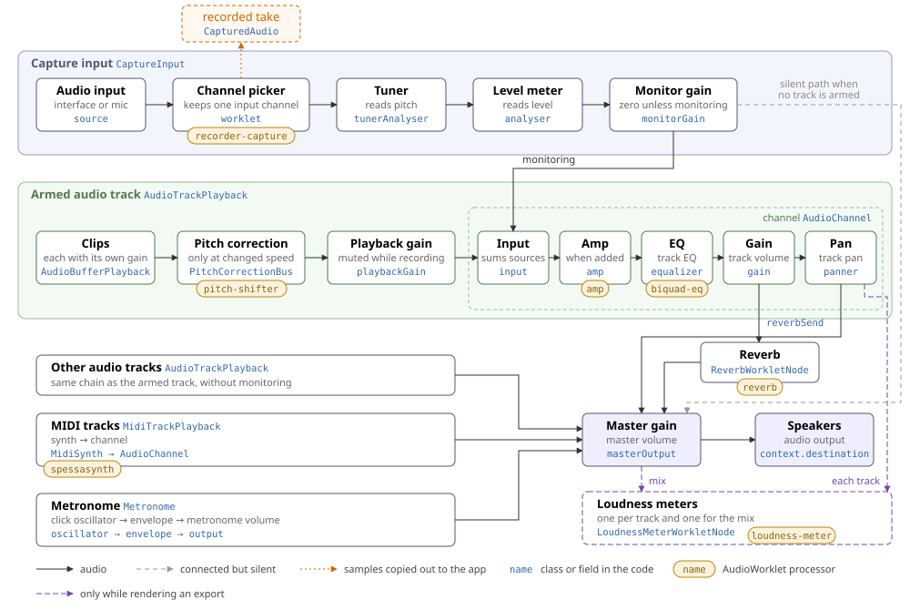

# Audio Signal Flow

- Every channel sends to one shared reverb after its gain, so a track's volume, mute, and solo apply to its reverb too. The reverb returns to the master gain.
- Monitoring goes through the armed track's channel, so the input follows that track's amp, EQ, volume, and pan.
- With no track armed, the monitor stays connected to the master gain but silent, because Chromium stops rendering a chain without a path to the output, which would stop the tuner.
- When Export Audio renders the mix, meters measure [loudness](concepts/loudness.md) after the master gain and after each track's pan. The reverb returns to the master gain, not to the track, so a track's number leaves out its reverb while the mix number includes all of it. The master gain scales a track's signal exactly, so the app applies it to the track's number by calculation instead of metering after it.
