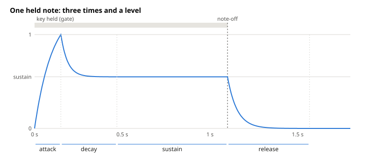
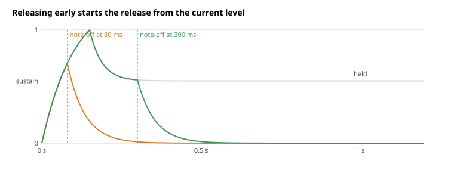

# ADSR Envelopes

An oscillator plays at a constant level for as long as it runs, so on its own every note starts at full level, stays there, and stops when its key is released. An **envelope** is a level from 0 to 1 that the synth multiplies into a note sample by sample, so the note can swell in, fade while held, or ring on after its key is released. The key's state drives it: pressing the key opens the **gate** with a note-on, and releasing it closes the gate with a note-off.

The standard envelope is the **ADSR**, named after its four settings, attack, decay, sustain, and release. In the [synth](../../src/lib/dsp/subtractive-synth.ts) each layer has its own amp envelope, and the layer's level is the envelope times the layer's gain times the note's velocity / 127.

This document explains what each setting means, how notes that end early behave, and how the synth's [envelope](../../src/lib/dsp/envelope.ts) curves each stage so that a time is the length you hear.

## Follow a Held Note Through Four Stages

- **Attack** is the time to rise from 0 to 1 after the note-on.
- **Decay** is the time to fall from 1 toward the sustain level.
- **Sustain** is a level, not a time. The envelope stays there for as long as the key is held.
- **Release** is the time to fall to 0 after the note-off.

So an ADSR is three times and a level. The envelope doesn't set how long a note lasts, since the sustain lasts as long as the key does. The release comes after the note-off, so a note keeps sounding for up to the release time after its key is released.

## Release from Wherever the Envelope Is

A note-off can arrive in any stage, and the release starts from whatever level the envelope has reached. A note shorter than the attack never reaches full level, which is why a slow attack makes short notes quieter. A note released during the decay never settles at the sustain level. In every case the level is continuous, because a jump in level is a click.

Each note gets its own envelope, starting from 0. Playing a pitch that is still sounding releases the earlier note, which fades out under the new one.

## Make Sounds from Four Settings

The sustain level decides which of the other settings matter.

- **At sustain 1** there is nothing to decay to, so the envelope is a gate with rounded edges, like an organ. The synth's default is this shape with 5 ms edges, short enough to sound immediate and long enough to keep notes from clicking.
- **At sustain 0** the note fades away while held, like a plucked string, and the decay sets how long it rings. The release only matters for notes released before the decay is over.
- **In between**, the decay is the strike and the sustain is the body of the note, like a piano with a quiet sustain or a pad that swells in.

## Shape Each Stage as a Curve

A stage's start level, end level, and time leave its shape open, and the shape is chosen by ear. Loudness is heard roughly in decibels, so a straight fade from 1 to 0 seems to hang near full level and then drop away, since halfway through its time it has fallen only 6 dB. A fade that falls by the same factor every sample, an exponential, loses the same number of decibels in each stretch of time and sounds even. Analog envelopes, which charge and discharge a capacitor, make this shape too, so it's the one synth players expect. The attack is the exception. A rise that is even in decibels would spend most of its time inaudibly low and then shoot up, which sounds sluggish, so the attack rises like a charging capacitor instead, quickly at first and easing into its peak.

The synth draws every stage with one rule. Each sample, it moves the level $x$ toward a **target** $T$ by the same fraction,

$$
x_{n+1}=T+c\cdot(x_n-T),
$$

so the distance to the target shrinks by a factor $c$ per sample. This is the exponential sampled exactly, as the [appendix](#appendix-sample-a-first-order-relaxation-exactly) shows, and it costs one multiply-add per sample. Because each step starts from the current level, a stage that starts partway, such as a release after an early note-off, needs nothing extra. The curve never reaches its target, so each stage aims an **overshoot** $o$ past its end level, $T=1+o$ for the attack and $T=E-o$ for a decay or release that ends at $E$, and the stage ends when $x$ crosses $E$. The distance then starts at $1+o$ over a full swing and ends at $o$. For a stage time of $N$ samples,

$$
(1+o)\cdot c^N=o,\qquad c=\left(\frac{o}{1+o}\right)^{1/N}.
$$

The overshoot decides how much of the exponential a stage uses, so each stage gets its own.

**The decay and release aim 0.0001 past their ends.** A small overshoot uses nearly the whole exponential, so the level falls evenly in decibels. Near the end, where the level is close to $o$, the $-o$ term takes over and the level drops to its end faster than the exponential would. That starts around

$$
20\log_{10}o=-80\ \text{dB},
$$

too quiet to hear, so the release sounds like an even fade to silence. An overshoot of 0.01 would bend at −40 dB, where a loud note's tail can be heard cut short.

**The attack aims 0.3 past 1, chosen by ear.** A large overshoot uses only the steep start of the exponential, so the attack is concave like an analog attack but close to a straight line, and it doesn't sound slow.

## Read a Time as the Stage's Length

Synths disagree on what an envelope time means. Here a time is how long the stage lasts over the full swing, so a 100 ms release from full level is silent at 100 ms. Another common convention takes the time as the curve's [time constant](#appendix-sample-a-first-order-relaxation-exactly) $\tau$, in which the distance to the target shrinks by a factor of $e$. Then falling 60 dB takes $\ln1000\cdot\tau\approx6.9\tau$, so the same 100 ms setting rings for most of a second. The full-swing convention makes the number on a slider match what you hear.

Times are also rates. A stage's $c$ is set for the full swing, so a decay or release that covers only part of it, such as a decay to the sustain level or a release from it, falls at the same speed and ends sooner, as on analog envelopes. Because an exponential's tail passes quickly, falling half the swing still takes about 92% of the time. The other choice, finishing every stage in its time whatever the distance, would make the decay's speed change when the sustain changes.

## References

- [Envelope generators—ADSR code](https://www.earlevel.com/main/2013/06/03/envelope-generators-adsr-code/) (EarLevel Engineering) builds an ADSR from one-pole curves that aim past their ends, the same construction as here.
- [Envelope (music)](<https://en.wikipedia.org/wiki/Envelope_(music)>) (Wikipedia) surveys the ADSR and its variants.

## Appendix: Sample a First-Order Relaxation Exactly

The stage curve is the motion of a level that moves toward its target at a speed proportional to the distance left,

$$
\frac{dx}{dt}=\frac{T-x}{\tau},
$$

where $\tau$ is the **time constant**. A capacitor charging through a resistor toward a supply voltage follows this equation. The distance $T-x$ obeys the same equation with its target at 0, so it decays as an exponential:

$$
T-x(t)=\big(T-x(0)\big)\cdot e^{-t/\tau}.
$$

Over one sample, $1/F_s$ seconds, the distance shrinks by the same factor whatever came before, which gives the recurrence of [Shape Each Stage as a Curve](#shape-each-stage-as-a-curve):

$$
x_{n+1}=T+c\cdot(x_n-T),\qquad c=e^{-1/(\tau F_s)}.
$$

So the recurrence is the continuous curve sampled exactly, not a step-by-step approximation of it. Forward Euler, which moves $x$ at its current speed for one sample, would give $c=1-1/(\tau F_s)$ instead, which comes close only when $\tau$ spans many samples.

Smoothing a measured level toward each new reading, as the [level meters](../../src/lib/level-meters.ts) do, steps the same equation with a target that changes every step. There the recurrence is required, because the target isn't known ahead of time. Here it's a convenience, since each stage's start, end, and time are known and a closed form would draw the same curve.

Putting this $c$ into the main text's $(1+o)\cdot c^N=o$ gives the time constant of a stage that lasts $N/F_s$ seconds:

$$
\tau=\frac{N/F_s}{\ln\big((1+o)/o\big)}.
$$

A decay or release, with $o=0.0001$, has a time constant of its time divided by 9.2, so a 100 ms release has $\tau\approx11$ ms. The attack, with $o=0.3$, has a time constant of its time divided by 1.47. Under the time-constant convention, a release set to 100 ms would have $\tau=100$ ms and take 9.2 times as long, about 0.92 s, to fall the same 80 dB.
