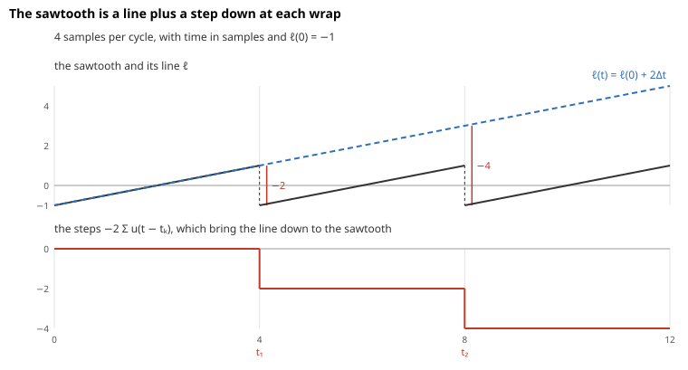
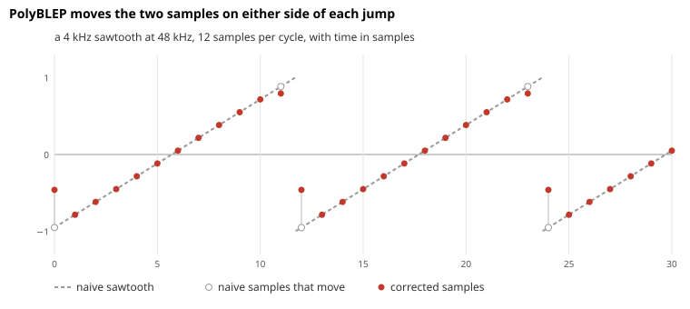

# Band-Limited Oscillators

The synth's **oscillator** is the stage that produces a note's samples, one at a time. Each waveform it can play is a formula over the cycle, such as the sawtooth, which rises in a straight line and jumps back down. The formula describes a continuous waveform, defined at every instant rather than only at the sample times. The simplest oscillator, called **naive** here, evaluates the formula at each sample time, which is the same as sampling the continuous waveform directly. For a sawtooth or square that aliases, because their jumps carry harmonics far above what the sample rate can hold.

A continuous waveform is called **band-limited** when it has no frequencies above the Nyquist frequency, so sampling it doesn't alias. A **band-limited oscillator** produces the samples of the band-limited version of its waveform, which is the continuous waveform with every harmonic above the Nyquist frequency removed, instead of the samples of the waveform itself. The synth's sawtooth and square come close to that with a correction called PolyBLEP.

This document shows where the aliasing comes from, why filtering or oversampling doesn't remove it, and how the [synth](../../src/lib/dsp/subtractive-synth.ts) rounds each jump with PolyBLEP. It builds on [See Why Clipping Aliases](oversampling.md#see-why-clipping-aliases), which explains how a frequency above the Nyquist frequency folds back below it.

Throughout, $F_s$ is the sample rate, 48 kHz in the examples, $f_0$ is the note's frequency, and the oscillator's **phase** $\varphi$ runs from 0 to 1 over each cycle, advancing by $\Delta=f_0/F_s$ cycles per sample.

## See Why a Jump Aliases

The oscillator reads each waveform at its phase. The sawtooth is $2\varphi-1\mathrm{}$, which rises from −1 to 1 and then jumps back down, and the square is 1 for the first half of the cycle and −1 for the second. Written as sums of sines, the waveforms have these harmonics:

| Waveform | Harmonics            | Falloff of the $n$-th |
| -------- | -------------------- | --------------------- |
| Sine     | the fundamental only |                       |
| Triangle | odd                  | $1/n^2\mathrm{}$      |
| Sawtooth | every one            | $1/n\mathrm{}$        |
| Square   | odd                  | $1/n\mathrm{}$        |

**How fast the harmonics fall depends on the sharpest feature of the shape.** The sawtooth and square jump, and their harmonics fall as $1/n\mathrm{}$, which is 6 dB per octave. The triangle never jumps, but its slope changes suddenly at each corner, and its harmonics fall as $1/n^2\mathrm{}$, which is 12 dB per octave. The two are related by integration. The triangle's slope is a square wave, so the triangle is a square integrated, and integrating divides the $n$-th harmonic by its frequency, which adds one more factor of $n$. The [appendix](#appendix-split-each-harmonic-at-the-jumps) derives both rates.

**The harmonics never stop, so some always fold.** Computing the waveform sample by sample is the same as sampling the ideal waveform, so every harmonic above $F_s/2$ folds back as an alias. For a sawtooth at 1 kHz, the 25th harmonic, at 25 kHz, is the first past the 24 kHz Nyquist frequency, and it lands at 23 kHz only 28 dB below the fundamental, because $1/25\mathrm{}$ is −28 dB. The harmonics near 48 kHz are still only about 34 dB down, and they fold to just above 0 Hz, where the ear is far more sensitive than near 24 kHz. The aliases don't fall on multiples of $f_0$, so they sound like inharmonic tones, and they move the wrong way when the pitch moves. The same 25th harmonic of a 1 kHz triangle is 56 dB down, since $1/25^2\mathrm{}$ is −56 dB.

## Rule Out Filtering Afterwards and Oversampling

**A low-pass after the oscillator can't remove aliasing.** Once a harmonic has folded, it's a component inside the band like any other, at a frequency the waveform should have had nothing at. A filter can only act on frequencies, so it can't separate the alias from the waveform. A subtractive synth's own filter is no help for the same reason, because it comes after the folding.

**Oversampling only pushes the problem higher.** The [amp's drive](guitar-amp-simulation.md) runs at 4× the rate, so that harmonics up to 96 kHz are represented and filtered out before returning to 48 kHz. That works for the drive because a clipper's harmonics are weak by 96 kHz. A sawtooth's harmonics still fall only as $1/n\mathrm{}$, so the ones past 96 kHz fold just as before, four times higher and so only 12 dB quieter. The table below includes a sawtooth computed at 4× and brought back to 48 kHz through an ideal low-pass, which is the best that oversampling can do.

## Replace Each Jump with a Band-Limited Step

The band-limited version of a waveform is the waveform passed through a perfect low-pass at $F_s/2$. That low-pass [convolves](fourier-series.md#filter-by-convolving-with-a-kernel) with the sinc from [Upsample by Interpolating](oversampling.md#upsample-by-interpolating), whose spectrum is 1 up to $F_s/2$ and 0 above. Call that kernel $h$ and work out what it does to the sawtooth.

**Convolve each piece of the sawtooth with $h$.** With $t$ in samples and the phase at 0 when $t=0$, the phase is $\Delta t$ less its whole cycles, so the sawtooth $2\varphi-1$ splits into a line and a staircase:

$$
\varphi=\Delta t-\lfloor\Delta t\rfloor,\qquad \text{sawtooth}(t)=\ell(t)-2\lfloor\Delta t\rfloor,\qquad \ell(t)=2\Delta t-1.
$$

The line $\ell$ is the sawtooth of a phase that never wraps. The floor counts the wraps, so it rises by the unit step $u$ at each wrap time $t_k=k/\Delta$:

$$
u(t)=\begin{cases}
0 & t\lt0,\\
1 & t\ge0.
\end{cases}
$$

Since $\ell(t-s)=\ell(t)-2\Delta s$, the line comes through on two properties of the sinc. It sums to 1, because its spectrum is 1 at 0 Hz, and it's even, so it weighs $s$ and $-s$ equally and $\int s\cdot h(s)ds=0$. The step keeps only the part of $h$ before $t$, its running integral $S_h$:

$$
(h*\ell)(t)=\int h(s)\cdot\ell(t-s)ds=\ell(t)\int h(s)ds-2\Delta\int s\cdot h(s)ds=\ell(t),
$$

$$
(h*u)(t)=\int h(s)\cdot u(t-s)ds=\int_{-\infty}^{t}h(s)ds=S_h(t).
$$

So the low-passed sawtooth is the ideal one with every step $u$ replaced by $S_h$, which is the ideal sawtooth plus the **residual** $r_h=S_h-u$ at each jump, scaled by the jump:

$$
h*\text{sawtooth}=\text{sawtooth}-2\sum_k r_h(t-t_k).
$$

Two things follow. The line passes through untouched, so all of the high harmonics, and with them all the aliasing, come from the jumps, which the [appendix](#appendix-split-each-harmonic-at-the-jumps) shows exactly. And the samples of the ideal sawtooth are the naive samples, so the oscillator only has to add the residual near each jump. The oscillator knows a jump is coming, because the phase says when it will wrap, so it can correct the samples before the jump as well as after. The square is made of steps alone, so the same holds for it.

**The step becomes a BLEP.** The sinc's running integral $S_h$ rises smoothly through the jump instead of all at once and ripples on both sides of it, as the blue curve in the figure below shows. This band-limited step is called a **BLEP**, from **B**and-**L**imited st**EP**, and its residual is large next to the jump and dies away on either side.

The sinc never ends, so neither does its residual, and a real oscillator needs an approximation. Tabulating a shortened residual is one way. It's accurate, but it needs a table and spreads each correction over many samples.

## Low-Pass the Ideal Waveform with a Short Triangle

PolyBLEP instead swaps the sinc for the bump of [linear interpolation](oversampling.md#upsample-by-interpolating), the triangle two samples wide, $b(t)=1-|t|$ for $|t|\lt1$. It's a much cruder low-pass than the sinc, but it reaches only one sample on each side. It's even and sums to 1, the two properties the line needed, so the derivation above applies with $h=b$, and integrating $b$ gives a step that rises over one sample on each side, with a residual of two pieces:

$$
S_b(t)=\begin{cases}
0 & t\le-1,\\
\tfrac{1}{2}(1+t)^2 & -1\le t\le0,\\
1-\tfrac{1}{2}(1-t)^2 & 0\le t\le1,\\
1 & t\ge1,
\end{cases}\qquad r(t)=S_b(t)-u(t)=\begin{cases}
\tfrac{1}{2}(1+t)^2 & -1\lt t\le0,\\
-\tfrac{1}{2}(1-t)^2 & 0\le t\lt1,
\end{cases}
$$

and $r$ is 0 farther than one sample from the jump. The residual is two quadratic pieces, which is where PolyBLEP, a **poly**nomial BLEP, gets its name.

**In frequency, each harmonic is scaled by the triangle's spectrum.** [Convolving](fourier-series.md#filter-by-convolving-with-a-kernel) scales each tone by the kernel's spectrum, and the triangle's is $\text{sinc}^2(f/F_s)$, as [oversampling](oversampling.md#upsample-by-interpolating) shows. So every harmonic is scaled by $\text{sinc}^2(f/F_s)$ before the waveform is sampled, and two consequences follow:

- **Aliases that would land at low frequencies nearly vanish.** The triangle's spectrum is zero at every multiple of $F_s$, so the harmonics near 48 kHz and 96 kHz, which would fold to just above 0 Hz, are cut deeply before they fold. Below 5 kHz, the correction lowers the loudest alias by about 40 dB.
- **Aliases close to 24 kHz and the top harmonics are cut only a little.** The spectrum is about 0.4 at $F_s/2$, which is −7.8 dB, so harmonics just past 24 kHz fold back to just below it only about 8 dB quieter. The same factor dulls the waveform's own top, by 1.2 dB at 10 kHz and 5.3 dB at 20 kHz, which the spectrum of the corrected sawtooth shows as harmonics falling below their ideal $1/n\mathrm{}$ level.

So the aliasing that remains sits near the top of the band, where the ear is least sensitive.

## Correct the Two Samples Next to Each Jump

**Only the two samples next to a jump change.** The residual is zero beyond one sample from the jump, so only the last sample before it and the first sample after it need correcting. The phase gives their distance from the jump. A sample whose phase is $\varphi\lt\Delta$ is $t=\varphi/\Delta$ samples after the wrap, and one with $\varphi\gt1-\Delta$ is $t=(\varphi-1)/\Delta$ samples before it, which is negative.

**The synth's correction is the residual for a jump of 2.** The sawtooth and square jump between −1 and 1, which is twice the unit step, so the correction is $2r(t)\mathrm{}$. That's $(1+t)^2=t^2+2t+1$ before the jump and $-(1-t)^2=2t-t^2-1$ after it, the two branches in the code. The sawtooth jumps down at $\varphi=0$, so it subtracts the correction. The square jumps up at $\varphi=0$ and down at $\varphi=\tfrac{1}{2}$, so it adds the correction at its phase and subtracts it half a cycle later:

## Measure the Aliasing

The synth rendered each note at a frequency that fits the analysis window exactly, so the spectrum needs no window and every harmonic and alias lands on its own frequency. The naive and 4× columns compute the sawtooth the same way without the correction. The first number is the energy of all the aliases from 0 to 24 kHz relative to the harmonics, and the second, in parentheses, is the loudest alias below 5 kHz relative to the fundamental:

| Note    | Sawtooth, naive | Sawtooth, 4× with an ideal low-pass | Sawtooth, PolyBLEP | Triangle, uncorrected |
| ------- | --------------- | ----------------------------------- | ------------------ | --------------------- |
| 254 Hz  | −22 dB (−45)    | −35 dB (−57)                        | −38 dB (−83)       | −67 dB (−89)          |
| 1006 Hz | −16 dB (−33)    | −29 dB (−45)                        | −31 dB (−71)       | −49 dB (−65)          |
| 4007 Hz | −9 dB (−21)     | −22 dB (−33)                        | −23 dB (−63)       | −31 dB (−42)          |

The square measures the same as the sawtooth or up to 5 dB lower. PolyBLEP, which changes two samples per jump at the original rate, does slightly better than ideal 4× oversampling over the full band, and 26 to 30 dB better below 5 kHz.

## Leave the Triangle's Corners Uncorrected for Now

The triangle has no jumps, and its harmonics already fall as $1/n^2\mathrm{}$, so the synth computes it without a correction. For low notes that's enough, but the table shows its limit. From about 1 kHz up, the uncorrected triangle has louder aliases below 5 kHz than the corrected sawtooth, and at 4 kHz it's 21 dB worse.

The triangle's corners can be corrected the same way. A corner is a change of slope, which is a ramp, 0 before the corner and $t$ after it. Convolving the ramp with $b$, as with the step, gives the **BLAMP**, from **B**and-**L**imited r**AMP**. Its residual, the difference from the naive ramp, is the integral of $r$, $\tfrac{1}{6}(1+t)^3$ before the corner and $\tfrac{1}{6}(1-t)^3$ after it, scaled by the change of slope per sample. The triangle's slope changes by $8\Delta\mathrm{}$ at each corner, so the correction grows with the note's frequency, which matches where the uncorrected triangle falls behind. [The synth](../../src/lib/dsp/subtractive-synth.ts) doesn't apply it yet, and adding it is a TODO there.

## References

- T. Stilson and J. Smith, [Alias-Free Digital Synthesis of Classic Analog Waveforms](https://ccrma.stanford.edu/~stilti/papers/blit.pdf), band-limited impulse trains, where the idea of building a waveform from band-limited discontinuities comes from
- E. Brandt, [Hard Sync Without Aliasing](https://www.cs.cmu.edu/~eli/papers/icmc01-hardsync.pdf), the BLEP residual as a table, added at each jump
- V. Välimäki, J. Pekonen, and J. Nam, [Perceptually Informed Synthesis of Bandlimited Classical Waveforms Using Integrated Polynomial Interpolation](https://doi.org/10.1121/1.3651227), the polynomial BLEP and BLAMP corrections and how audible their remaining aliases are

## Appendix: Split Each Harmonic at the Jumps

This appendix makes two claims from the main text exact: that a sawtooth's high harmonics come entirely from its jump, and that the sharpest feature of a shape sets how fast its harmonics fall.

**Setup.** Let $x(\varphi)$ have period 1 and be smooth except at the phases $\varphi_1,\dots,\varphi_m$ in each cycle, where it may jump by $J_k=x(\varphi_k^+)-x(\varphi_k^-)$. Its $n$-th Fourier coefficient is

$$
c_n=\int_0^1 x(\varphi)\,e^{-2\pi in\varphi}\,d\varphi,
$$

and for a real waveform the $n$-th harmonic has amplitude $2|c_n|\mathrm{}$.

**Integrate by parts between the jumps.** On one smooth piece from $a$ to $b$,

$$
\int_a^b x(\varphi)\,e^{-2\pi in\varphi}\,d\varphi=\Big[\frac{x(\varphi)\,e^{-2\pi in\varphi}}{-2\pi in}\Big]_a^b+\frac{1}{2\pi in}\int_a^b x'(\varphi)\,e^{-2\pi in\varphi}\,d\varphi.
$$

Summing over the pieces of a cycle, each break $\varphi_k$ is the end of one piece and the start of the next, so its two boundary terms combine into $\big(x(\varphi_k^-)-x(\varphi_k^+)\big)e^{-2\pi in\varphi_k}$ divided by $-2\pi in$, which is $J_ke^{-2\pi in\varphi_k}/(2\pi in)$. Where the waveform is continuous the two terms cancel, and periodicity joins the last piece to the first. So

$$
c_n=\frac{1}{2\pi in}\sum_{k=1}^{m}J_k\,e^{-2\pi in\varphi_k}+\frac{1}{2\pi in}\,c_n[x'],
$$

where $x'$ is the slope of the smooth pieces, without the jumps, and $c_n[x']$ is its $n$-th coefficient. The first term comes from the jumps alone. Each jump contributes the same magnitude $|J_k|$ to every harmonic, so after the factor $1/(2\pi in)\mathrm{}$ it falls as $1/n\mathrm{}$. The second term comes from the smooth pieces alone.

**The sawtooth is all jump.** The sawtooth $2\varphi-1\mathrm{}$ has slope 2 everywhere, and a constant has no harmonics, since $\int_0^1 2\,e^{-2\pi in\varphi}\,d\varphi=0$ for every $n\neq0$. So the second term vanishes, and with its one jump $J=-2$ at $\varphi=0$,

$$
c_n=\frac{-2}{2\pi in},\qquad 2|c_n|=\frac{2}{\pi n},
$$

exactly, for every harmonic. All of the sawtooth's harmonics, and so all of its aliases, are the jump's. The square is the same, with $J=2$ at $\varphi=0$ and $J=-2$ at $\varphi=\tfrac12$ and no slope at all, so $c_n=2\big(1-e^{-i\pi n}\big)/(2\pi in)$, which is 0 for even $n$ and gives $2|c_n|=4/(\pi n)\mathrm{}$ for odd $n$.

**Repeating the split gives the falloff.** The second term is $c_n[x']$ divided by $2\pi in\mathrm{}$, and $c_n[x']$ splits the same way at the jumps of $x'$, which are the corners of $x$. So jumps in $x$ give harmonics falling as $1/n\mathrm{}$, corners give $1/n^2\mathrm{}$, jumps in the curvature give $1/n^3\mathrm{}$, and so on, and the lowest derivative that jumps sets the falloff. In the usual terms, a function is called $C^k$ when it and its first $k$ derivatives are continuous, and **piecewise smooth** when it's smooth between finitely many breaks. A piecewise smooth waveform that is $C^{k-1}$ but whose $k$-th derivative jumps has harmonics falling as $1/n^{k+1}\mathrm{}$. The sawtooth and square aren't even $C^0$, so theirs fall as $1/n\mathrm{}$, the triangle is $C^0$ but not $C^1$, so its fall as $1/n^2\mathrm{}$, and a $C^\infty$ waveform's fall faster than any power of $n$. The triangle has no jumps, so its first term vanishes. Its slope is 4 for $\varphi$ from $-\tfrac14$ to $\tfrac14$ and −4 for the rest of the cycle, so the slope jumps by −8 at $\varphi=\tfrac14$ and by 8 at $\varphi=\tfrac34$, and has no slope of its own. Applying the formula to the slope,

$$
c_n[x']=\frac{8\big(e^{-3i\pi n/2}-e^{-i\pi n/2}\big)}{2\pi in},
$$

which is 0 for even $n$ and has magnitude $16/(2\pi n)\mathrm{}$ for odd $n$. Dividing by $2\pi in\mathrm{}$ once more gives $2|c_n|=8/(\pi^2n^2)\mathrm{}$, the $1/n^2\mathrm{}$ falloff in the table.

**The same split is what the corrections use.** It writes the waveform as a smooth part plus a step at each jump and a ramp at each corner. Adding a BLEP residual replaces a step with its band-limited version, and adding a BLAMP residual does the same for a ramp. For the sawtooth and square, the smooth part has no harmonics, so replacing the steps leaves nothing that can alias. In the language of distributions, the split says that each jump puts an impulse of weight $J_k$ into the slope, and an impulse contains every frequency at equal strength.

## Appendix: Read Odd Harmonics from Half-Wave Symmetry

The square and triangle have only odd harmonics, while the sawtooth has every one. The jump formula shows this by computation, but the shapes tell it directly.

**Half-wave symmetry is a property of the shape.** A waveform is called **half-wave symmetric** when its second half-cycle is its first upside down,

$$
x(\varphi+\tfrac12)=-x(\varphi).
$$

The square is half-wave symmetric, because its 1 becomes −1, and so is the triangle, whose fall mirrors its rise, and the sine. The sawtooth isn't, because it keeps rising through both halves of the cycle.

**Split the coefficient at the half cycle.** Write $c_n$ as the integral over the first half plus the integral over the second, and move the second half back onto the first by substituting $\varphi=\psi+\tfrac12$:

$$
c_n=\int_0^{1/2}x(\psi)\,e^{-2\pi in\psi}\,d\psi+\int_0^{1/2}x(\psi+\tfrac12)\,e^{-2\pi in(\psi+\frac12)}\,d\psi.
$$

In the second integral, the symmetry turns $x(\psi+\tfrac12)$ into $-x(\psi)$, and the exponential splits into $e^{-2\pi in\psi}$ times the constant $e^{-i\pi n}=(-1)^n$. So the second integral is $-(-1)^n$ times the first, and

$$
c_n=\big(1-(-1)^n\big)\int_0^{1/2}x(\psi)\,e^{-2\pi in\psi}\,d\psi.
$$

**Even harmonics cancel and odd ones double.** The factor is 0 for even $n$ and 2 for odd $n$. Half a cycle of the fundamental is $n/2$ cycles of the $n$-th harmonic, which is $n\pi$ radians. An even harmonic is shifted by whole cycles of its own, so it's the same in both halves, and the waveform's sign flip makes the two halves cancel. An odd harmonic is shifted by an odd number of half cycles, so it flips sign too, the two flips undo each other, and the halves add. So a half-wave symmetric waveform has only odd harmonics, and each is twice the integral over the first half cycle. The converse holds too, because the half-cycle shift multiplies every odd harmonic by $(-1)^n=-1$, so a waveform with only odd harmonics satisfies $x(\varphi+\tfrac12)=-x(\varphi)$.

In the jump formula, the symmetry pairs each jump with an opposite one half a cycle later, and the pair contributes $J\big(1-(-1)^n\big)e^{-2\pi in\varphi_k}$, which cancels for even $n$, as the square's two jumps showed.

**Every waveform splits into an odd part and an octave-up part.** Write

$$
x(\varphi)=\underbrace{\frac{x(\varphi)-x(\varphi+\frac12)}{2}}_{\text{half-wave symmetric}}+\underbrace{\frac{x(\varphi)+x(\varphi+\frac12)}{2}}_{\text{repeats every half cycle}}.
$$

The first part is half-wave symmetric, so it holds the odd harmonics. The second repeats every half cycle, so it's a waveform an octave up, and its harmonics are the even harmonics of $x$. For the sawtooth, the second part works out to a sawtooth an octave up at half the height, $\tfrac12\big(2(2\varphi \bmod 1)-1\big)$, which matches its even harmonics, since the $2m\mathrm{}$-th harmonic's amplitude $2/(2\pi m)\mathrm{}$ is half of the $m$-th.

**This is a different question from odd and even functions.** Whether $x(-\varphi)=x(\varphi)$ or $x(-\varphi)=-x(\varphi)$ decides whether the harmonics are cosines or sines, measured from $\varphi=0$, not which harmonics are present. The sawtooth $2\varphi-1\mathrm{}$ is an odd function, since $x(1-\varphi)=-x(\varphi)$, and it still has every harmonic. The [amp's clipper](guitar-amp-simulation.md#appendix-why-an-odd-clipper-adds-only-odd-harmonics) is odd in another sense, as a function of the signal's value, and that oddness does matter, because it carries the input sine's half-wave symmetry through to its output.

**Missing even harmonics sound hollow.** The second harmonic is the octave above the note and the fourth is two octaves above, so a waveform without even harmonics has none of the octaves that reinforce its pitch. The square and triangle sound hollow and reedy for that reason, and the sawtooth, with every harmonic, sounds full and bright. A clarinet has a similar spectrum in its low register. Its bore is a cylinder closed at the reed end, which resonates at odd multiples of its lowest frequency, so its low notes are mostly odd harmonics. A bowed string moves in a sawtooth-like way and has every harmonic, which is part of why a sawtooth makes a natural string or brass sound.
