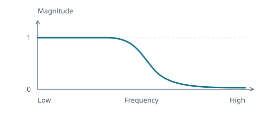

# Designing Low-Pass and High-Pass Filters

The [peaking EQ](peaking-eq.md) boosts or cuts a band and leaves the rest of the spectrum alone. A low-pass or high-pass filter instead removes one end of the spectrum, such as the fizz above a guitar speaker's range or the rumble below a guitar's lowest note. As with the peaking EQ, we start only from the response we want and let it decide the coefficients.

The [transfer-function article](transfer-functions.md#the-continuous-counterpart-of-the-sample-recurrence) gives us a second-order family to work with:

$$
H_a(s)=\frac{c_2s^2+c_1s+c_0}{s^2+d_1s+d_0}.
$$

Here $s$ is the continuous complex rate, and a tone is evaluated at $s=j\Omega$.

## Construct a Low-Pass Response

A low-pass filter should leave slow variation unchanged while suppressing rapid oscillation. We want unity at zero frequency and a response that tends to zero as frequency increases. How much of the second-order family do those requirements determine?



_Schematic response. The transition shape depends on $Q$._

### Preserve Low Frequencies and Suppress High Frequencies

At zero frequency, only the constant terms remain. At high frequency, the leading powers dominate:

$$
H_a(0)=\frac{c_0}{d_0}=1,
\qquad
\lim_{|s|\to\infty}H_a(s)=c_2=0.
$$

Thus $c_0=d_0$ and $c_2=0$, leaving

$$
H_a(s)=\frac{c_1s+d_0}{s^2+d_1s+d_0}.
$$

The endpoints alone do not fix the rate of attenuation. If $c_1\ne0$, then $H_a(s)$ behaves like $c_1/s$ at high frequency, so it reaches zero only as fast as $1/|s|$. To make the magnitude fall as $1/|s|^2$, which is a 12 dB drop per octave, we additionally require $c_1=0$:

$$
H_a(s)=\frac{d_0}{s^2+d_1s+d_0}.
$$

This second-order rolloff is a design choice beyond merely reaching zero.

### Separate Frequency Scale from Damping

The denominator's roots describe the filter's natural motion, which is the damped oscillation $y''+d_1y'+d_0y=0$ from the [transfer-function article](transfer-functions.md#the-continuous-counterpart-of-the-sample-recurrence). Taking $d_0,d_1\gt0$ puts both roots in the left half-plane, so that motion decays. Without the damping term, the denominator $s^2+d_0$ has roots $\pm j\sqrt{d_0}$. This identifies the undamped natural frequency $\Omega_0=\sqrt{d_0}$.

Measure the complex rate relative to that frequency, $u=s/\Omega_0$. Dividing both polynomials by $\Omega_0^2$ gives

$$
H_a(\Omega_0u)=\frac{1}{u^2+(d_1/\Omega_0)u+1}.
$$

At the natural frequency, $u=j$, the quadratic and constant terms cancel:

$$
H_a(j\Omega_0)=-j\frac{\Omega_0}{d_1}.
$$

The remaining ratio measures the response at that frequency. Naming it $Q=\Omega_0/d_1$ gives

$$
H_{\text{LP}}(u)=\frac{1}{u^2+u/Q+1}.
$$

This **quality factor** expresses damping relative to the frequency scale. We can now investigate which $Q$ gives the transition we want.

### Choose a Flat Passband

The squared magnitude shows how $Q$ shapes the passband. Write $\nu=\Omega/\Omega_0$ for the relative frequency. Substituting $u=j\nu$ gives

```math
\begin{aligned}
|H_{\text{LP}}(j\nu)|^2
&=\frac{1}{(1-\nu^2)^2+\nu^2/Q^2}\\
&=\frac{1}{1+(Q^{-2}-2)\nu^2+\nu^4}.
\end{aligned}
```

Near zero frequency, the $\nu^2$ term determines how the response leaves unity. When $Q^{-2}\gt2$, the denominator increases, so the magnitude falls. When $Q^{-2}\lt2$, the denominator initially decreases, so the magnitude rises above unity before falling, creating a bump in the passband.

To keep the passband as flat as possible near zero frequency, cancel the $\nu^2$ term:

$$
Q^{-2}-2=0,
\qquad
Q=\frac{1}{\sqrt{2}}.
$$

The squared magnitude then becomes

$$
|H_{\text{LP}}(j\nu)|^2=\frac{1}{1+\nu^4}.
$$

At $\nu=1$, the magnitude is $1/\sqrt2$, approximately $-3$ dB. Thus **$Q\approx0.71$ gives the flat-passband setting**, with the selected frequency at the $-3$ dB point. Above this $Q$, a peak develops before the rolloff. This maximally flat choice is the second-order **Butterworth** filter.

Unlike the peaking EQ, this filter has no independent center-gain control. Its magnitude at $\Omega_0$ is $Q$, so $Q=1$ means 0 dB at that frequency even though the surrounding response has a peak. The same knob controls damping and the level at the selected frequency.

## Mirror It into a High-Pass Response

A high-pass filter wants the opposite: unity at high frequency and zero at zero frequency. Rather than repeat the construction, swap the roles of low and high frequencies. Replacing $u$ by $1/u$ sends $\nu$ to $1/\nu$ on the frequency axis, so whatever the low-pass did near zero, the result does near infinity, and the reverse:

$$
H_{\text{HP}}(u)=H_{\text{LP}}(1/u)=\frac{1}{u^{-2}+u^{-1}/Q+1}=\frac{u^2}{u^2+u/Q+1}.
$$

It keeps the low-pass's denominator, so its natural frequency and damping are the same, and only the numerator changes, from $1$ to $u^2$. Its magnitude is the low-pass's read at $1/\nu$,

$$
|H_{\text{HP}}(j\nu)|^2=\frac{1}{1+(Q^{-2}-2)\nu^{-2}+\nu^{-4}},
$$

so the same $Q=1/\sqrt2$ makes the high-pass flat as $\nu\to\infty$, with the selected frequency again at $-3$ dB, and it falls at 12 dB per octave below it.

## Convert the Prototypes to Sample Coefficients

[Prewarping and the bilinear map](bilinear-transform.md#place-the-center-with-prewarping) send the selected frequency $\omega_0=2\pi f_0/F_s$ to $u=j$ through

$$
u\leftarrow K\frac{1-d}{1+d},
\qquad K=\cot\frac{\omega_0}{2},
\qquad d=z^{-1}.
$$

This preserves the response value at the selected frequency, so the digital filter is $-3$ dB exactly at $f_0$ for $Q=1/\sqrt2$, and preserves the order of response values along the frequency axis.

### Reuse One Quadratic Expansion

The peaking derivation expanded $u^2+cu+1$. The low-pass and high-pass numerators have zero leading or constant terms, so extend the same calculation to $p_2u^2+p_1u+p_0$. Clearing $(1+d)^2$ gives

$$
P(d)=p_2K^2(1-d)^2+p_1K(1-d)(1+d)+p_0(1+d)^2.
$$

Multiplying by the common scale $2/(K^2+1)$ and using the half-angle identities

$$
\frac{K^2}{K^2+1}=\frac{1+\cos\omega_0}{2},
\qquad
\frac{1}{K^2+1}=\frac{1-\cos\omega_0}{2},
\qquad
\frac{K}{K^2+1}=\frac{\sin\omega_0}{2}
$$

expands it as $\frac{2}{K^2+1}P(d)=q_0+q_1d+q_2d^2$, whose weights on the constant, one-delay, and two-delay terms are

```math
\begin{aligned}
q_0&=(p_2+p_0)+(p_2-p_0)\cos\omega_0+p_1\sin\omega_0,\\
q_1&=2\bigl[(p_0-p_2)-(p_2+p_0)\cos\omega_0\bigr],\\
q_2&=(p_2+p_0)+(p_2-p_0)\cos\omega_0-p_1\sin\omega_0.
\end{aligned}
```

Use the analog coefficients from each prototype in this expansion:

| Prototype | Numerator $(p_2,p_1,p_0)$ | Denominator $(p_2,p_1,p_0)$ |
| --------- | ------------------------- | --------------------------- |
| Low-pass  | $(0,0,1)$                 | $(1,1/Q,1)$                 |
| High-pass | $(1,0,0)$                 | $(1,1/Q,1)$                 |

The numerator's three outputs are $(b_0,b_1,b_2)$ and the denominator's are $(a_0,a_1,a_2)$. Divide all six by $a_0$ to obtain the five weights used by the [sample loop](../../../src/lib/dsp/biquad-filter.ts).

### Recognize the Implementation's Coefficients

Divide both triples by two and write $\alpha=\sin\omega_0/(2Q)$. The shared denominator becomes

$$
(a_0,a_1,a_2)=(1+\alpha, -2\cos\omega_0, 1-\alpha),
$$

and the numerators become

$$
(b_0,b_1,b_2)_{\text{LP}}=\frac{1-\cos\omega_0}{2}(1,2,1),
\qquad
(b_0,b_1,b_2)_{\text{HP}}=\frac{1+\cos\omega_0}{2}(1,-2,1).
$$

The numerators show the mirroring in the $z$-plane. The low-pass's $(1,2,1)=(1+d)^2$ puts a double zero at $z=-1$, the Nyquist frequency, and the high-pass's $(1,-2,1)=(1-d)^2$ puts it at $z=1$, zero frequency, which is why each blocks its end of the spectrum completely.

## Cascade Sections for a Steeper Rolloff

One second-order section falls 12 dB per octave. A steeper filter is built by running sections one after another, which multiplies their responses, so their dB responses add and so do their slopes: two sections fall 24 dB per octave, three 36. Building high orders from second-order sections rather than one long recurrence also keeps the arithmetic well conditioned, since each section's two poles stay where they were designed.

Cascading identical sections doesn't give a higher-order Butterworth. Two Butterworth low-passes at the same $f_0$ multiply to

$$
|H(j\nu)|^2=\frac{1}{(1+\nu^4)^2},
$$

which is $-6$ dB at $f_0$ rather than $-3$, with a softer knee. That combination is the 4th-order **Linkwitz–Riley** filter. A 4th-order Butterworth, flat out to a sharper knee, instead uses two sections with different $Q$, about $0.54$ and $1.31$, whose product is $1/(1+\nu^8)$.
