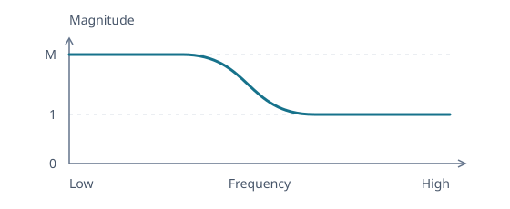

# Designing Low-Shelf and High-Shelf Filters

A shelf raises or lowers one end of the spectrum and leaves the other end alone, like the bass and treble knobs on an amp. It sits between the two earlier designs. Like the [peaking EQ](peaking-eq.md), it changes a level rather than removing anything, and like the [low-pass and high-pass](low-pass-and-high-pass.md), it acts on a whole end of the spectrum rather than a band. As before, we start only from the response we want and let it decide the coefficients.

The [transfer-function article](transfer-functions.md#the-continuous-counterpart-of-the-sample-recurrence) gives us a second-order family to work with:

$$
H_a(s)=\frac{c_2s^2+c_1s+c_0}{s^2+d_1s+d_0}.
$$

Here $s$ is the continuous complex rate, and a tone is evaluated at $s=j\Omega$.

## Construct a Low-Shelf Response

A low shelf should change the level of low frequencies while preserving high frequencies.



_Schematic response showing a boost, with $M\gt1$._

### Connect Two Nonzero Levels

Require $H_a(0)=M$ and $H_a(\infty)=1$, where $M\gt0$ is the low-frequency amplitude ratio. Values above one boost, and values below one cut. The endpoint conditions give $c_0=Md_0$ and $c_2=1$:

$$
H_a(s)=\frac{s^2+c_1s+Md_0}{s^2+d_1s+d_0}.
$$

The levels leave $c_1$, $d_1$, and $d_0$ free to determine the transition. We still need a meaning for the selected frequency and a way to prevent overshoot.

### Choose a Frequency Scale Between the Two Quadratics

For $d_0\gt0$, substituting $s=j\Omega$ gives

$$
H_a(j\Omega)=\frac{Md_0-\Omega^2+jc_1\Omega}{d_0-\Omega^2+jd_1\Omega}.
$$

The real parts of the numerator and denominator vanish at $\sqrt{Md_0}$ and $\sqrt{d_0}$, respectively. These give two frequency scales. Choose $\Omega_0$ halfway between them on a logarithmic frequency axis, which means taking their geometric mean:

$$
\Omega_0=\sqrt{\sqrt{Md_0}\sqrt{d_0}},
\qquad
\Omega_0^2=\sqrt{M}\cdot d_0.
$$

Write $A=\sqrt M$, so $d_0=\Omega_0^2/A$, and normalize with $u=s/\Omega_0$. Dividing by $\Omega_0^2$ and rescaling the denominator gives

$$
H_a(\Omega_0u)
=A\frac{u^2+c_nu+A}{Au^2+c_du+1},
\qquad
c_n=\frac{c_1}{\Omega_0},
\qquad
c_d=\frac{Ad_1}{\Omega_0}.
$$

Choose positive $c_n,c_d$ so both quadratics have decaying modes. The frequency scale is now centered between the two quadratics, but that alone does not make its response halfway between the two levels.

### Place the Center Halfway Between the Levels

We want the selected frequency to lie halfway between the plateau levels in decibels, so its amplitude must be $\sqrt M=A$. At $u=j$,

$$
H_a(j\Omega_0)=A\frac{(A-1)+jc_n}{(1-A)+jc_d}.
$$

The real parts have equal squared magnitude, so $|H_a(j\Omega_0)|=A$ requires $c_n^2=c_d^2$. With positive coefficients, this means $c_n=c_d=c$, leaving

$$
H_a(\Omega_0u)=A\frac{u^2+cu+A}{Au^2+cu+1}.
$$

The two levels and their midpoint now have the intended values. When $M=1$, the numerator and denominator coincide and the response is flat. The remaining coefficient $c$ determines how the curve travels between the levels.

### Avoid Overshoot Between the Plateaus

A shelf should move from the low-frequency level $M$ to the high-frequency level 1 without overshooting either plateau. For a boost, the magnitude should decrease throughout the transition, and for a cut, it should increase.

Write $x=(\Omega/\Omega_0)^2$ and remove the constant gain factor from the squared magnitude:

$$
R(x)=\frac{|H_a(j\Omega_0\sqrt{x})|^2}{A^2}
=\frac{(A-x)^2+c^2x}{(1-Ax)^2+c^2x},
\qquad x\ge0.
$$

As frequency rises, $x$ increases, so the sign of $R'$ tells us whether the shelf rises or falls. Differentiating gives

$$
R'(x)=
\frac{(1-A^2)\left[(c^2-2A)(x^2+1)+2(1+A^2)x\right]}
{\left[(1-Ax)^2+c^2x\right]^2}.
$$

The denominator is positive. For a boost, $A\gt1$, so the factor $1-A^2$ is negative, and for a cut it is positive. These are the signs of a falling and a rising shelf, provided the bracket stays nonnegative.

The sign of $c^2-2A$ decides the shape. If it is negative, the bracket is negative at $x=0$, so the curve first moves away from its destination: a boost rises above its low-frequency plateau, and a cut dips below it. If instead

$$
c^2\ge2A,
$$

every term in the bracket is nonnegative for $x\ge0$, so the magnitude moves monotonically from $M$ to 1 and stays between those levels.

### Choose the Steepest Monotonic Transition

Within the monotonic family, $c$ still controls how gradual the transition is. At the midpoint, $x=1$,

$$
|R'(1)|=\frac{2|1-A^2|}{(A-1)^2+c^2}.
$$

Increasing $c$ flattens the transition, so the steepest one without overshoot sits at the boundary

$$
c=\sqrt{2A}.
$$

This gives the low-shelf prototype

$$
H_{\text{LS}}(u)
=A\frac{u^2+\sqrt{2A}u+A}{Au^2+\sqrt{2A}u+1}.
$$

Every coefficient is now fixed by the gain, so unlike the peaking EQ and the pass filters, the shelf has no $Q$ control. The [Audio EQ Cookbook](https://www.w3.org/TR/audio-eq-cookbook/) keeps $c$ adjustable through a shelf slope $S$, and this boundary is its $S=1$, which it describes as the steepest slope that keeps the gain monotonic.

## Mirror It into a High-Shelf Response

A high shelf wants the same transition with the ends swapped: unity at low frequencies and $M$ at high frequencies. As with the [high-pass](low-pass-and-high-pass.md#mirror-it-into-a-high-pass-response), replace $u$ by $1/u$, which sends $\nu=\Omega/\Omega_0$ to $1/\nu$ on the frequency axis:

$$
H_{\text{HS}}(u)=H_{\text{LS}}(1/u)=A\frac{Au^2+\sqrt{2A}u+1}{u^2+\sqrt{2A}u+A}.
$$

Each quadratic now has its leading and constant coefficients swapped. The levels trade ends, $H_{\text{HS}}(0)=1$ and $H_{\text{HS}}(\infty)=A^2=M$, and since reversing the frequency axis preserves the midpoint and monotonicity, the high shelf is still halfway at $\Omega_0$ and never overshoots.

## Convert the Prototypes to Sample Coefficients

[Prewarping and the bilinear map](bilinear-transform.md#place-the-center-with-prewarping) send the selected frequency $\omega_0=2\pi f_0/F_s$ to $u=j$, zero frequency to $z=1$, and infinite frequency to the Nyquist frequency $z=-1$. The digital shelf therefore keeps both plateaus and is exactly halfway between them at $f_0$.

The low-pass article [expands a general quadratic](low-pass-and-high-pass.md#reuse-one-quadratic-expansion) $p_2u^2+p_1u+p_0$ into three delay weights:

```math
\begin{aligned}
q_0&=(p_2+p_0)+(p_2-p_0)\cos\omega_0+p_1\sin\omega_0,\\
q_1&=2\bigl[(p_0-p_2)-(p_2+p_0)\cos\omega_0\bigr],\\
q_2&=(p_2+p_0)+(p_2-p_0)\cos\omega_0-p_1\sin\omega_0.
\end{aligned}
```

The shelves supply these coefficients, with the outer factor $A$ in each numerator:

| Prototype  | Numerator $(p_2,p_1,p_0)$ | Denominator $(p_2,p_1,p_0)$ |
| ---------- | ------------------------- | --------------------------- |
| Low shelf  | $(A,A\sqrt{2A},A^2)$      | $(A,\sqrt{2A},1)$           |
| High shelf | $(A^2,A\sqrt{2A},A)$      | $(1,\sqrt{2A},A)$           |

The numerator's three outputs are $(b_0,b_1,b_2)$ and the denominator's are $(a_0,a_1,a_2)$. Divide all six by $a_0$ to obtain the five weights used by the [sample loop](../../../src/lib/dsp/biquad-eq.ts).

### Recognize the Implementation's Coefficients

Write $\beta=\sqrt{2A}\sin\omega_0$ for the linear term. Substituting the low-shelf row gives

```math
\begin{aligned}
b_0&=A\bigl[(A+1)-(A-1)\cos\omega_0+\beta\bigr],
&a_0&=(A+1)+(A-1)\cos\omega_0+\beta,\\
b_1&=2A\bigl[(A-1)-(A+1)\cos\omega_0\bigr],
&a_1&=-2\bigl[(A-1)+(A+1)\cos\omega_0\bigr],\\
b_2&=A\bigl[(A+1)-(A-1)\cos\omega_0-\beta\bigr],
&a_2&=(A+1)+(A-1)\cos\omega_0-\beta.
\end{aligned}
```

The high-shelf row swaps $p_2$ and $p_0$, which leaves $p_2+p_0$ alone and negates $p_2-p_0$. Every $A-1$ above changes sign and nothing else does, so the implementation computes both shelves from one formula. The cookbook writes the linear term as $2\sqrt A\alpha$ with $\alpha=\sin\omega_0/\sqrt2$ at $S=1$, which is the same $\beta$.

At $A=1$, every $A-1$ term vanishes and the numerator equals the denominator, so a flat shelf is exactly the identity, as a flat peaking EQ is.

## References

- R. Bristow-Johnson, [Audio EQ Cookbook](https://www.w3.org/TR/audio-eq-cookbook/), whose shelf formulas with $S=1$ are the coefficients above, in the same convention as the [peaking EQ](peaking-eq.md)
