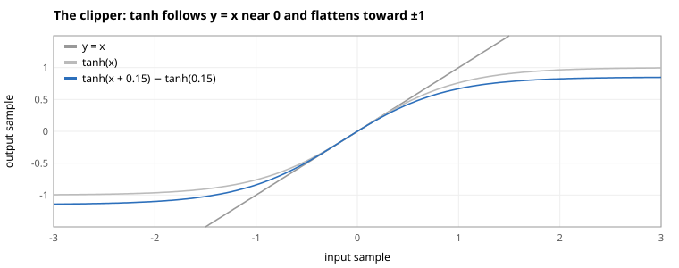
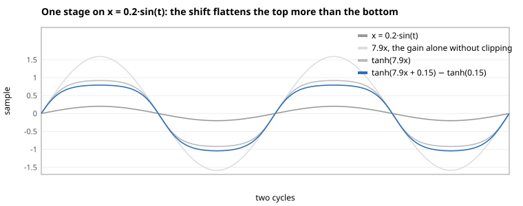
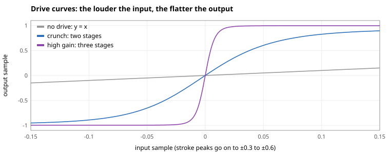
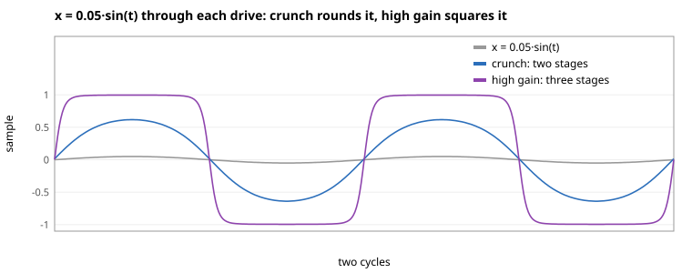
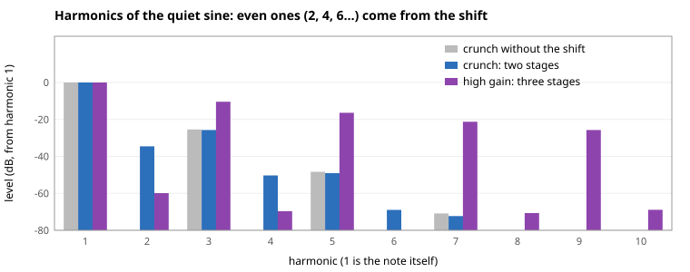
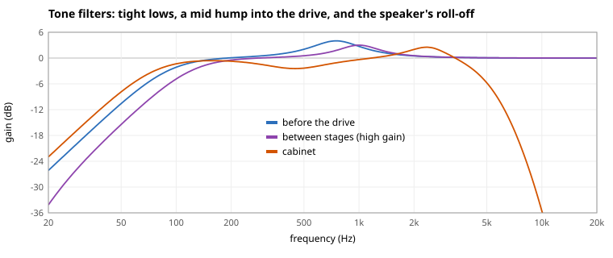

# Guitar Amp Simulation

A clean DI guitar, which is the signal straight from the pickup, sounds thin and polite next to a recorded electric guitar. Most of the difference is the amp and its speaker. The amp's preamp amplifies the signal far past what it can pass cleanly, so it flattens the wave's peaks, and the speaker rolls off the harsh top end that flattening adds. This document develops a model of that chain and the equations used in [our implementation](../../src/lib/dsp/amp.ts):

$$
\text{pre-EQ} \rightarrow \text{drive} \rightarrow \text{cabinet}.
$$

Throughout, $x$ is a sample in $[-1, 1]$.

## Flatten the Wave with a Gain Stage

A preamp is a chain of **gain stages**, such as tube triodes, each amplifying the signal and clipping it softly once pushed too hard. Model one stage as a gain $g$ followed by a soft clipper:

$$
y = \tanh(g x).
$$

Since $\tanh u \approx u$ for small $u$ and $\tanh u \to \pm 1$ for large $u$, the gain decides how much of the wave reaches the flat part. Since $\tanh$ is odd, meaning $\tanh(-u) = -\tanh u$, it flattens the top and bottom of a wave alike. That adds only odd harmonics, as the [appendix](#appendix-why-an-odd-clipper-adds-only-odd-harmonics) shows.

A tube stage biased off center flattens one side sooner. Model it by shifting the wave up the curve before clipping and back down after:

$$
s(u) = \tanh(u + b) - \tanh b, \qquad b = 0.15.
$$

It saturates at $1 - \tanh b \approx 0.85$ above and $-1 - \tanh b \approx -1.15$ below, so the top flattens first, which adds even harmonics too. Subtracting $\tanh b$ keeps $s(0) = 0$, so silence stays silent. Flattening one side more also leaves a slowly varying offset in the output, which would shift the next stage's clipping, so a 20 Hz high-pass after $s$ removes it.

On $x = 0.2 \sin t$, one stage with $g = 7.9$ flattens the top and bottom alike without the shift, and the top more than the bottom with it:

## Chain Stages to Sustain a Decaying Note

Chaining stages raises the overall gain while every stage keeps its output within about $\pm 1$. Leaving out the filters between stages, the two drives are

$$
D_\text{crunch}(x) = \tanh\big(2.0 \cdot s(7.9 x)\big), \qquad
D_\text{high gain}(x) = \tanh\Big(3.2 \tanh\big(5.0 \cdot s(7.9 x)\big)\Big).
$$

Their **small-signal gain**, which is the slope at 0, is

$$
D'(0) = 7.9 \text{sech}^2 b \cdot 2.0 \approx 15.5 \quad (24\text{ dB}), \qquad
7.9 \text{sech}^2 b \cdot 5.0 \cdot 3.2 \approx 123 \quad (42\text{ dB}),
$$

and an input well above $1/D'(0)$, which is $0.06$ for crunch and $0.008$ for high gain, comes out nearly square:

A guitar's peaks, about $0.3$ to $0.6$, are far above both, so every stroke's attack comes out nearly square. The drives differ on a decaying note. At $x = 0.05 \sin t$, the note is below crunch's $0.06$ but far above high gain's $0.008$, so crunch only rounds it while high gain still squares it. A string's decay barely changes the output of high gain, which is why it sustains:

The harmonics of that sine show the shift at work. Crunch with $\tanh$ in place of $s$, in gray, has only odd harmonics, and crunch with $s$ adds even ones:

This holds for one pure sine. A real guitar note already carries even harmonics, and a chord's notes also produce sum and difference tones between them, so "odd harmonics only" describes the clipper, not what comes out of it on a guitar.

The drive's output sits near $\pm 1$ at any input level, far louder than a dry track, so a gain of −18 dB after it brings it back toward the dry signal's level.

## Shape the Tone Around the Drive

Filters before, between, and after the stages decide which frequencies get distorted and which reach the listener. All are second-order [digital filters](digital-filters/README.md) designed through the bilinear transform: [high-passes and low-passes](digital-filters/low-pass-and-high-pass.md) with the flat-passband Butterworth $Q = 1/\sqrt{2}$, and [peaking filters](digital-filters/peaking-eq.md).

Peaking widths are given in octaves, which the [peaking design converts to $Q$](digital-filters/peaking-eq.md#measure-the-halfway-bandwidth). One octave is $Q\approx1.41$.

| Where            | Purpose                                                                                              | Filters                                                                                                                    |
| ---------------- | ---------------------------------------------------------------------------------------------------- | -------------------------------------------------------------------------------------------------------------------------- |
| Before the drive | Keep the low end tight under distortion, and put a mid hump in front like an overdrive pedal         | 90 Hz high-pass, +4 dB at 750 Hz over 1.2 octaves                                                                          |
| Between stages   | Add to the mid hump, and cut the lows before more gain like a high-gain preamp's coupling capacitors | +2 dB (crunch) or +3 dB (high gain) at 1 kHz over 1 octave, 120 Hz high-pass (high gain)                                   |
| Cabinet          | A guitar speaker: mostly a roll-off from about 5 kHz that removes the fizz clipping adds             | 75 Hz high-pass, 5.2 kHz low-pass twice and 7 kHz once, +3 dB at 2.4 kHz over 1 octave, −2.5 dB at 450 Hz over 1.5 octaves |

The cabinet's roll-off is three low-passes in a row, which is the usual way to [build a steep filter](digital-filters/low-pass-and-high-pass.md#cascade-sections-for-a-steeper-rolloff): two identical Butterworth sections at 5.2 kHz for a soft knee, and a third at 7 kHz that steepens the fall further up. Without them, the drive's high harmonics come through as raw fizz.

The structure follows common amp design, but the values were picked by ear in an offline prototype, not fitted to a real amp, so they're starting presets.

## Oversample the Drive to Avoid Aliasing

A signal sampled at $f_s$ can't hold frequencies above $f_s/2$, which is its Nyquist frequency, and clipping adds harmonics above it. Computed sample by sample at $f_s$, a harmonic at $f > f_s/2$ folds back to $f_s - f$. At 48 kHz, a 27 kHz harmonic lands at 21 kHz, which is no longer a multiple of the note, and these folded tones sound like inharmonic fizz.

So the drive runs at $4 f_s$, between an upsampler and a downsampler, and the filters before and after it stay at $f_s$. [Oversampling](oversampling.md) develops the up- and downsampling and their low-pass filter, and measures the aliasing with and without it.

## References

- J. Pakarinen and D. T. Yeh, [A Review of Digital Techniques for Modeling Vacuum-Tube Guitar Amplifiers](https://doi.org/10.1162/comj.2009.33.2.85), a survey that runs from static clippers with filters around them, like this model, to full circuit simulations
- J. O. Smith, [Nonlinear Distortion](https://ccrma.stanford.edu/~jos/pasp/Nonlinear_Distortion.html) and [Soft Clipping](https://ccrma.stanford.edu/~jos/pasp/Soft_Clipping.html), guitar distortion as a memoryless clipping curve, with notes on the aliasing it causes
- The [amp prototype](https://github.com/hi-ogawa/toy-midi/pull/963), which picked the chain and its values by ear on rendered demo pieces and documents what each stage changed

## Appendix: Why an Odd Clipper Adds Only Odd Harmonics

> 🚧 TODO: not yet internalized by the author.

**Claim.** If $f$ is odd, then $y(t) = f(A \sin \omega t)$ has only odd harmonics.

**Proof.** With $x(t) = A \sin \omega t$ and period $T = 2\pi/\omega$, the input flips sign over half a period, $x(t + T/2) = -x(t)$, and $f$ keeps that:

$$
y(t + T/2) = f\big(x(t + T/2)\big) = f\big(-x(t)\big) = -f\big(x(t)\big) = -y(t).
$$

Write $y$ as a [Fourier series](fourier-series.md). Shifting by $T/2$ multiplies the $n$-th term by $e^{i n \pi} = (-1)^n$:

$$
y(t) = \sum_n c_n e^{i n \omega t}, \qquad y(t + T/2) = \sum_n (-1)^n c_n e^{i n \omega t}.
$$

Matching coefficients with $-y(t)$ gives $(-1)^n c_n = -c_n$, so $c_n = 0$ for every even $n$. $\blacksquare$

The property the proof uses, $y(t + T/2) = -y(t)$, is called half-wave symmetry. The [Fourier series doc](fourier-series.md#read-odd-harmonics-from-half-wave-symmetry) derives it for any waveform, and [band-limited oscillators](band-limited-oscillators.md#appendix-read-odd-harmonics-from-half-wave-symmetry) uses it to read the square's and triangle's odd harmonics from their shapes.

The same shows through powers. An odd $f$ has only odd powers in its Taylor series, as in $\tanh u = u - u^3/3 + 2u^5/15 - \cdots$, and odd powers of a sine hold only odd harmonics, for example $\sin^3 t = \tfrac{3}{4} \sin t - \tfrac{1}{4} \sin 3t$, while even powers hold even harmonics and a constant, as in $\sin^2 t = \tfrac{1}{2} - \tfrac{1}{2} \cos 2t$.

The shifted stage isn't odd. Its expansion around 0 has a square term,

$$
s(u) = \text{sech}^2 b \cdot u - \tanh b \text{sech}^2 b \cdot u^2 + O(u^3),
$$

with $\tanh b \text{sech}^2 b \approx 0.15$ at $b = 0.15$. The $u^2$ term gives the 2nd harmonic and a constant, which the 20 Hz high-pass after $s$ removes.
