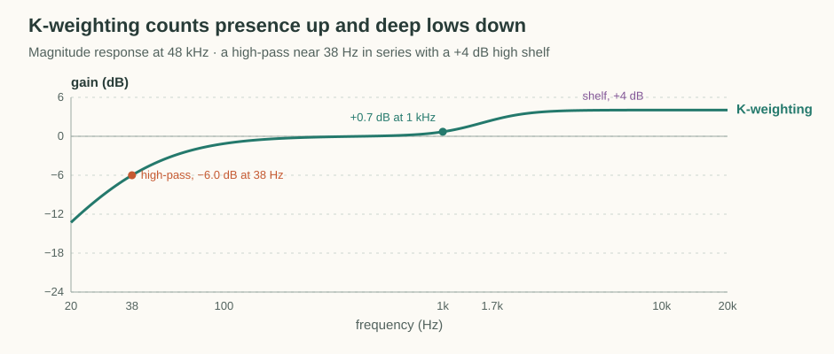
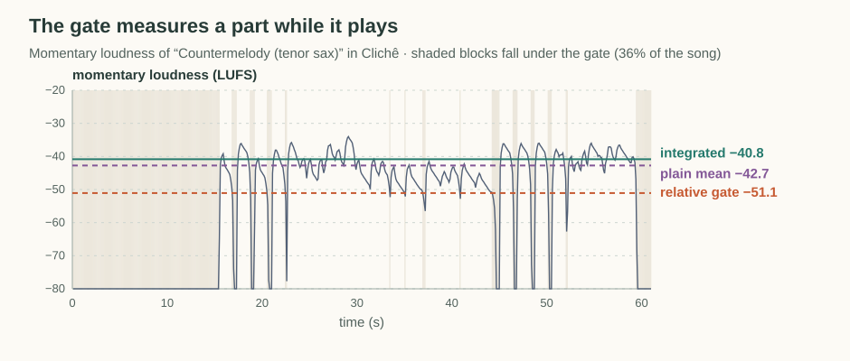
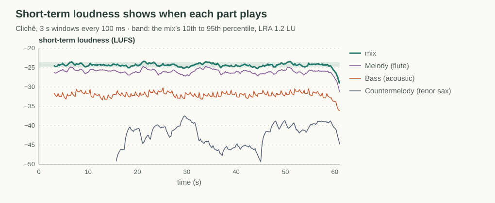
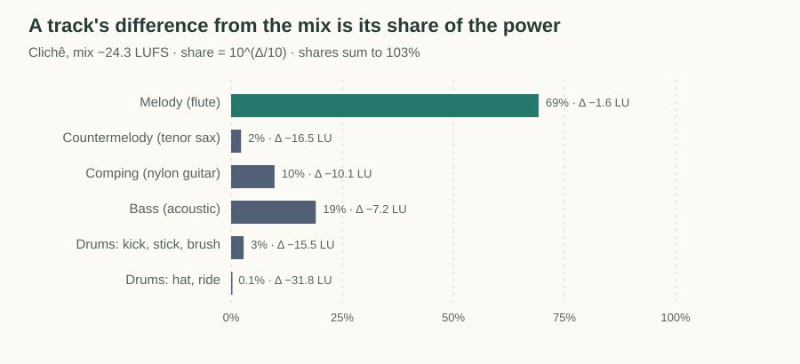

# Loudness

A peak meter says how close a signal comes to full scale, but not how loud it sounds. A dense pad and a sparse plucked bass can peak at the same level while one sounds far louder than the other. Streaming services normalize playback by loudness, at around −14 LUFS, and they only turn loud tracks down. A quiet export therefore plays quieter than everything around it, however clean its peaks are.

The app measures the loudness of the mix and of each track while it renders the audio Export Audio writes, the way [ITU-R BS.1770](https://www.itu.int/rec/R-REC-BS.1770) defines it, with loudness range from [EBU Tech 3342](https://tech.ebu.ch/publications/tech3342). The numbers match what ffmpeg's [`ebur128` filter](https://ffmpeg.org/ffmpeg-filters.html#ebur128) prints for the same file. This page explains what goes into them and how to read them.

## Weight the Signal Like an Ear

Loudness starts as mean power, like an RMS meter, but the signal is filtered first. The filter, called K-weighting, is two biquads in series:

- A high shelf of about +4 dB above roughly 1.5 kHz, which models how the head boosts presence frequencies.
- A high-pass around 38 Hz, 6 dB down at that frequency, which models how little the lowest frequencies contribute to perceived loudness.

[BS.1770](https://www.itu.int/rec/R-REC-BS.1770) publishes the coefficients only at 48 kHz. The meter uses analog parameters taken from [libebur128](https://github.com/jiixyj/libebur128/blob/67b33abe1558160ed76ada1322329b0e9e058b02/ebur128/ebur128.c#L251-L283), which ffmpeg's `ebur128` filter also uses. They are an unofficial fit that reproduces the published coefficients at 48 kHz through the bilinear transform. At other sample rates, the filters are that fit's choice, not the standard's.

TODO: Derive the analog prototypes from the published coefficients, the way the [digital filter articles](digital-filters/bilinear-transform.md) derive the peaking EQ, and settle what the meter does at other sample rates.

The consequence for mixing is that low end counts for less than a flat meter would show. A bass that reads 7 LU under the mix can still sound full, because much of its energy sits where K-weighting discounts it.

## Add Channels as Power

After weighting, each channel's mean square is added, with left and right weighted equally. Loudness is that sum on a log scale:

$$
L = -0.691 + 10 \log_{10} \sum_c \overline{y_c^2}.
$$

The −0.691 offset cancels K-weighting's gain at 1 kHz, so a full-scale 1 kHz sine in both channels reads 0 LUFS. One LU is one dB, so loudness differences read like fader moves.

Because channels add as power, panning changes loudness when the panner moves energy between channels. The app pans stereo sources with Web Audio's [`StereoPannerNode`](https://webaudio.github.io/web-audio-api/#stereopanner-algorithm), which folds one channel into the other rather than attenuating it, so a centered stereo voice gets up to 3 LU louder at hard pan. The meter measures after pan, so the numbers include this.

## Gate Out the Quiet Parts

Integrated loudness is not the mean over the whole file. The signal is cut into 400 ms blocks that overlap by 75%, and two gates decide which blocks count:

1. The absolute gate drops blocks below −70 LUFS, which removes silence.
2. The relative gate takes the mean power of the remaining blocks and drops those more than 10 LU below it.

The integrated value is the mean power of the blocks that pass both gates. This is why a part that rests for half the song reads at its playing level, not at its level averaged over the rests. The countermelody in the catalog song Clichê rests for its first 15 seconds and between phrases, so 36% of its blocks fall under the gate:

For dense parts the gate barely matters, because almost every block passes it.

## Measure the Range Between Sections

Loudness range (LRA) describes how much the level moves between sections. It uses 3 s short-term windows taken every 100 ms, gated at −70 LUFS and again 20 LU below their mean. LRA is the spread between the 10th and 95th percentiles of what remains, so a brief fill or a single loud hit doesn't widen it.

An LRA near 1 LU means the song sits at one level throughout. Arrangements usually lift a few LU into a chorus, and orchestral pieces can span 10 LU or more. Clichê measures 1.2 LU, which is very flat, and short-term loudness shows why:

The same curves also show what an integrated number hides, which is when each part plays and how its level moves between sections.

## Measure While Rendering

Every statistic above is built from mean power over windows that are whole multiples of 100 ms. A 400 ms block is four consecutive 100 ms segments, and a 3 s window is thirty. The meter therefore only keeps one number per 100 ms, the weighted power summed over channels. A whole song costs a few kilobytes, so the render measures every track alongside the mix instead of keeping each track's audio.

That list of powers is what the measurement returns. Integrated loudness and loudness range are computed from it, and so is anything else over time, such as the short-term curves above or the loudness of one section.

## Relate Track Loudness to the Mix

Each track is measured after its EQ, gain, pan, mute and solo, and the master gain, so its number describes what it contributes to the exported file. Gain is an exact offset, so 3 dB more on a fader reads 3 LU louder.

Track numbers don't add up to the mix number. The difference between a track and the mix converts to a power share, $`10^{\Delta/10}`$, where −3 LU is about half of the mix, −10 LU a tenth, and −20 LU one percent:

Those shares only sum to 100% for uncorrelated parts, and each track is gated on its own, so the sum lands near but not at 100%. This is why the mix is measured from the master rather than derived from the tracks.

Loudness doesn't model masking. A part 18 LU down in its own register can be clear, while one 8 LU down in the melody's register can disappear. Percussion also reads quieter than it sounds, because 400 ms blocks average its transients away. Use track numbers to find parts worth listening to, not as a verdict.

## Aim for a Delivery Level

A common target for music on streaming services is about −14 LUFS integrated. Master gain is an exact offset too, so a mix at −20 LUFS needs 6 dB more master gain to reach the target.

## References

- [ITU-R BS.1770](https://www.itu.int/rec/R-REC-BS.1770), which defines K-weighting and gating.
- [EBU Tech 3341](https://tech.ebu.ch/publications/tech3341), with test signals for integrated loudness.
- [EBU Tech 3342](https://tech.ebu.ch/publications/tech3342), which defines loudness range.
- [libebur128](https://github.com/jiixyj/libebur128), whose K-weighting design at arbitrary sample rates the meter follows.
