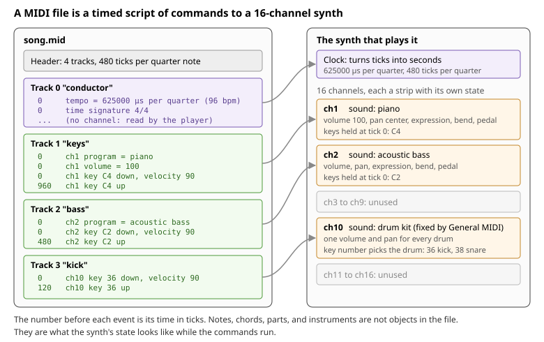
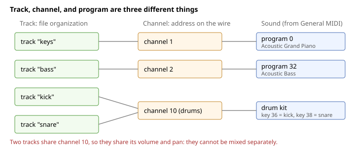
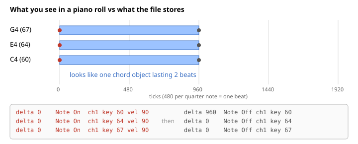
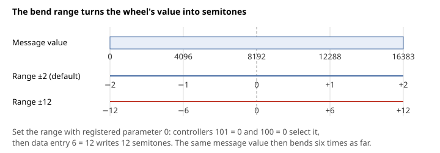
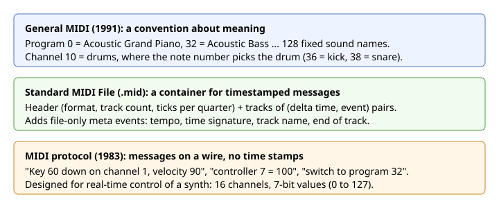

# What a MIDI File Can Encode

A Standard MIDI File describes a performance as timed commands to a synth. This document builds a model of what those commands are and what they leave out: tracks, channels, programs, events over time, and the tempo map. [Audio time units](audio-time-units.md) covers how ticks relate to beats, seconds, and samples.

## Read the File as a Script for a Synth



Think of two things: a synth and a script.

**The synth** is a 16-channel multitimbral module, like 16 instrument plugins on 16 mixer strips. Each channel strip has state: which sound is loaded, a few knobs (volume, pan, expression, modulation, sustain pedal, pitch bend), and which keys are currently held down. There is also a clock that turns ticks into seconds.

**The file** is a script of commands to that synth, each stamped with a time. A command does one of three things:

- Press or release a key on a channel ("ch2 key C2 down, velocity 90", "ch2 key C2 up")
- Change a channel's state ("ch1 volume = 100", "ch2 program = acoustic bass", "ch1 pitch bend up")
- Tell the player something that is not for a channel ("tempo = 96 bpm", "time signature 4/4", "this track is called keys")

Playing the file means running the script in time order. Everything musical (a note with a length, a chord, a part, an instrument choice) is not stored as an object. It is what the synth's state looks like while the script runs. A note is the span between a key going down and coming up. A chord is several keys going down at the same tick. An instrument is whatever program the channel was set to last.

As a data model:

```
MidiFile
  header
    format           0 = one track, 1 = several tracks played together
    ticksPerQuarter  time resolution, for example 480
  tracks: Track[]    containers only, they carry no sound of their own

Track = ordered list of (time in ticks, Event)

Event
  ChannelEvent       addressed to channel 1..16, sent to the synth
    note on          key 0..127, velocity 1..127
    note off         key
    control change   controller 0..127, value 0..127   (volume, pan, expression, sustain, ...)
    program change   program 0..127                    (which sound)
    pitch bend       value 0..16383, 8192 is no bend
    aftertouch       pressure while held
  MetaEvent          read by the player or an editor, never sent to the synth
    tempo, time signature, key signature, track name, text, lyric, marker, end of track
  SysEx              device-specific data
```

Every section below is a detail of this picture.

An audio analogy: the file is the MIDI clip lanes plus automation lanes from a DAW session, exported without the plugins. The receiving synth supplies the plugins, and General MIDI is the agreement on which preset number means which instrument.

## Separate Track, Channel, and Program



A DAW shows one "MIDI track" and hides that there are three things.

- **Track**: a list of events in the file, with an optional name. Tracks exist only for organization. A format 1 file has several tracks played together, and the first is conventionally a "conductor" track that holds tempo and time signature. A format 0 file merges everything into one track and plays identically, which shows that tracks carry no sound.
- **Channel**: what a synth actually listens to. Each event names its channel, so one track could in principle send to several channels, and several tracks can send to one channel. The usual convention is one track per channel.
- **Program**: the sound loaded on a channel, set by a program change. General MIDI maps the number to a name. A channel has one program at a time, so a file can have at most 16 simultaneous instruments, and 15 if channel 10 is used for drums.
- **Drums on channel 10**: the program is a drum kit, and the key number picks which drum (36 kick, 38 snare, 42 closed hat). So key 36 on channel 2 is a low C on the bass, and key 36 on channel 10 is a kick.

There is no "voice" or "part" concept in MIDI. A part is whatever you decide a track or a channel means.

The knobs belong to the channel, not to a note or a track. Volume, pan, program, pitch bend, and sustain apply to everything sounding on that channel at that moment. So bending one note of a chord bends all of them, and two drums on channel 10 cannot be panned apart.

Two of the knobs both set loudness, for different jobs. Volume (controller 7) sets the part's level in the mix and usually stays put, like a fader. Expression (controller 11) shapes the phrase within that level, such as a swell on a held note, so a swell never has to touch the mix balance. A knob only means something because the synth routes it somewhere. A SoundFont synth routes them by default modulators that every preset inherits: volume and expression attenuate each voice on a curve, modulation and channel aftertouch set vibrato depth, pan places the voice, and pitch bend shifts the pitch. A soundfont can add or override these routes, which is how the same controller can brighten one instrument and do nothing on another.

## Store a Note as Two Events



- **Duration** is not stored anywhere. It is the gap between a key's note on and its note off on the same channel.
- **A chord** is not stored either. It is several note ons that happen to share a time.
- **Velocity** is how hard the key was struck, fixed at the attack. Anything that changes during a held note (a swell, vibrato, a bend) must be a separate control change or pitch bend on the channel.
- **Overlap** is ambiguous. If the same key goes down twice on the same channel before it comes up, readers disagree about which one the note off ends. Same-pitch legato on one channel is fragile for this reason.
- **A swell is many events.** A control change is a single value at a moment, so a curve is a series of points, the way an automation lane is drawn.

## Scale Pitch Bend with a Range



Pitch bend has its own message and extra resolution. A control change carries 7 bits, but a pitch bend carries 14, from 0 to 16383 with 8192 as no bend, because the ear hears pitch in fine, absolute steps. With 7 bits over a range of 12 semitones each way, a step would be about 19 cents, and a slow slide would audibly climb a staircase. With 14 bits the step is about 0.15 cents.

The message says how far the wheel is pushed, not by how many semitones. The channel's **bend range** turns one into the other, and it defaults to 2 semitones each way, enough for a guitar bend but not a slide. The value also isn't symmetric: there are 8192 steps below center and 8191 above, so a bend of the full range up lands one step short.

The bend range has no controller of its own. It's a **registered parameter**, one of a handful of channel settings that are set through ordinary control changes in two steps. Controllers 101 and 100 select the parameter, then data entry (controllers 6 and 38) writes its value. Registered parameter 0 is the bend range, with controller 6 as semitones and 38 as cents, and parameters 1 and 2 are fine and coarse tuning. Non-registered parameters work the same way through controllers 99 and 98, with meanings that each synth defines. Because data entry writes to whichever parameter was selected last, it's good practice to end the exchange by selecting parameter 127/127, which selects nothing, so a stray data entry later can't change the bend range.

## Turn Ticks into Seconds

- The header sets the resolution, **ticks per quarter note**. With 480, a sixteenth is 120 ticks.
- Ticks become seconds only through **tempo events**, which store **microseconds per quarter note**, not BPM. 96 bpm is 60,000,000 / 96 = 625,000, and a file with no tempo event plays at 500,000 (120 bpm). This makes the player's job one division: seconds per tick = µs per quarter / ticks per quarter / 1,000,000.
- Tempo is always per quarter note, whatever the time signature says, so 6/8 at 60 dotted-quarter bpm is stored as 90 quarter bpm.
- A tempo change is just another event at a tick, and it is a jump. An accelerando is many small tempo events, the same way a swell is many control changes.
- **Time signature** is a label for notation software. Playback ignores it. Bars do not exist in the file, so there is no way to say "this is bar 3" except by counting ticks.
- Anything off the grid (swing, a laid-back snare, rubato) is just a different tick value. The file has no grid, which means it records feel exactly and never names it.

## Tell Apart the Three Standards Called MIDI



The model above mixes three standards that are all called MIDI:

- **The protocol** (1983) is the commands themselves, sent live over a cable from a keyboard to a synth. A command has no time inside it, because it happens when it arrives. The 16 channels come from here.
- **The Standard MIDI File** (`.mid`) records those commands with a time each, groups them into tracks, and adds the meta events that only make sense in a file, such as tempo.
- **General MIDI** (1991) is the agreement that program 32 is an acoustic bass and channel 10 is drums. Before it, "program 32" meant whatever your synth had in slot 32. It says nothing about how the sounds should actually sound, which is why the same file sounds different on every synth or soundfont.

## Know What a MIDI File Cannot Carry

MIDI is a performance recording format. It is exact about when and how hard, but silent about what or why.

- The sound itself. Only a program number, and the synth or soundfont decides what it sounds like.
- Musical meaning: chord names, scale degrees, bars, sections, repeats, phrase marks, which note is the melody. Everything is flattened to key numbers at ticks.
- Intent and comments. Text, lyric, and marker events exist, but no player acts on them.
- Articulation, except as whatever a particular synth does with control changes, separate programs (General MIDI has `Pizzicato Strings` as its own program), or keyswitch notes in sample libraries.
- Per-note control, mostly, because the knobs are per channel. MIDI 2.0 and the MPE convention (one note per channel) exist to get around this.

## Appendix: Bytes

Each channel event is a status byte, whose top half is the event type and whose bottom half is the channel (0 to 15 in bytes, so "channel 10" is 9), followed by one or two data bytes from 0 to 127. Each event in a track is preceded by its delta time, the ticks since the previous event, written as a variable-length number (0 is one byte, 960 is `87 40`).

| Event          | Bytes (hex)                        | Meaning                                                                               |
| -------------- | ---------------------------------- | ------------------------------------------------------------------------------------- |
| Note on        | `90 3C 5A`                         | Channel 1, key 60 (middle C), velocity 90                                             |
| Note off       | `80 3C 00`                         | Channel 1, key 60 up. A note on with velocity 0 means the same                        |
| Program change | `C1 20`                            | Channel 2 switches to program 32 (General MIDI: Acoustic Bass)                        |
| Control change | `B0 07 64`                         | Channel 1, controller 7 (volume) set to 100                                           |
| Pitch bend     | `E0 00 40`                         | Channel 1, bend at center, 14 bits                                                    |
| Bend range     | `B0 65 00`, `B0 64 00`, `B0 06 0C` | Channel 1 selects registered parameter 0, the bend range, and sets it to 12 semitones |
| Aftertouch     | `D0 xx`, `A0 kk xx`                | Pressure after the key is down, per channel or per key                                |
| Tempo (meta)   | `FF 51 03 09 89 68`                | 625000 microseconds per quarter note, which is 96 bpm                                 |

Controllers with fixed meaning in General MIDI: 1 modulation (vibrato in most synths), 7 channel volume, 10 pan, 11 expression, 64 sustain pedal, and 100 and 101 with data entry on 6 and 38 for registered parameters.
