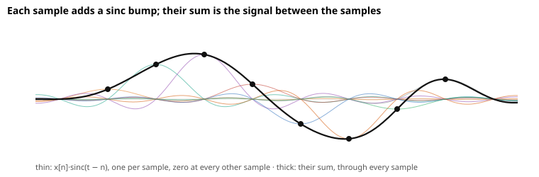
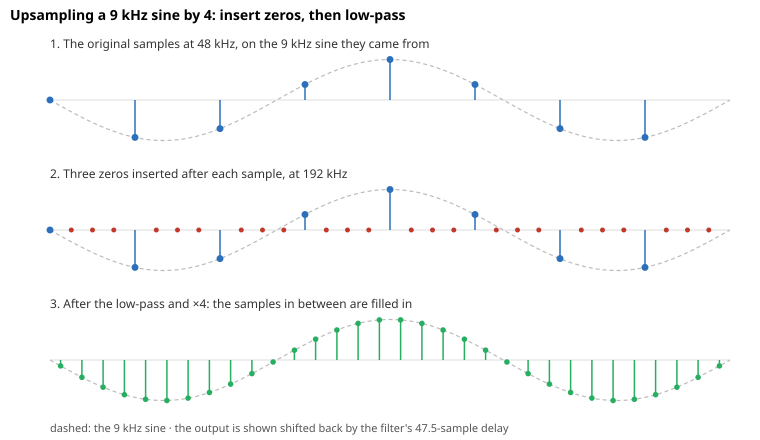
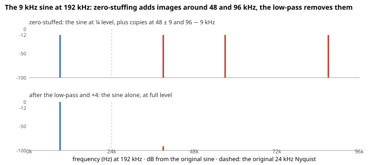

# Oversampling

A nonlinear process such as clipping creates frequencies its input didn't have, and some of them can be higher than the sample rate can hold. Computed at the original rate, those frequencies don't disappear but fold back as tones that were never in the music. Oversampling runs the process at a higher rate, where the new frequencies fit, and filters them out on the way back. This document develops that picture and the filters used in [our implementation](../../src/lib/dsp/oversampler.ts), which the [guitar amp](guitar-amp-simulation.md) runs its drive inside.

Throughout, $F_s$ is the original sample rate, 48 kHz in the examples, and $L=4$ is the oversampling factor.

## See Why Clipping Aliases

Sampling at $F_s$ takes the nth sample at time $n/F_s$, and at those times it can't tell some frequencies apart. A cosine at any frequency $f$ and one at $F_s-f$ give the same samples, since

$$
\cos\Big(2\pi(F_s-f)\frac{n}{F_s}\Big)=\cos\Big(2\pi n-2\pi f\frac{n}{F_s}\Big)=\cos\Big(2\pi f\frac{n}{F_s}\Big).
$$

So every frequency above the **Nyquist frequency** $F_s/2$ has a twin below it, and a sample sequence can only represent frequencies up to $F_s/2$. A frequency $f$ above it shows up as its **alias** $F_s-f$, and more generally as $|f-mF_s|$ for the integer $m$ that lands it in $[0,F_s/2]$.

A linear filter never creates frequencies, so this only matters when something new is made. Clipping a note at $f_0$ makes harmonics at $kf_0$ for $k=2,3,\dots$, and a hard-driven clipper makes many of them. For a 1318 Hz lead note, the 19th harmonic is at 25 kHz, past the 24 kHz Nyquist frequency, and computing the clipper sample by sample at 48 kHz puts it at $48-25=23$ kHz instead. The 21st, at 27.7 kHz, lands at 20.3 kHz, and so on down. These folded tones aren't multiples of $f_0$, so they sound like inharmonic fizz, and on a bend they move the wrong way, falling as the note rises.

## Raise the Rate, Process, and Come Back

If the clipper runs at $LF_s$, its Nyquist frequency is $LF_s/2$, 96 kHz at $L=4$, and harmonics up to there are represented correctly. Only harmonics above 96 kHz still fold, and a clipper's harmonics are weak that high. Afterwards everything above the original $F_s/2$ is removed before returning to $F_s$, so those harmonics are cut instead of folded.

### Upsample by Interpolating

Running the clipper at $LF_s$ needs values between the original samples, $L-1$ new ones after each. Filling them in is interpolation, and the obvious ways are to repeat each sample or to draw straight lines between samples. Both work the same way, because each sample places a bump centered on itself, scaled by its value, and the bumps add up. With $t$ counted in original samples,

$$
x(t)=\sum_n x[n] \cdot b(t-n),
$$

where the bump $b$ is a box one sample wide for repeating and a triangle two samples wide for straight lines. Each bump is 1 at its own sample and 0 at the others, so the curve passes through every sample, and the bump's shape decides what happens between them.

**The sinc is the exact bump.** A signal with nothing above $F_s/2$ is fully determined by its samples, and the sampling theorem rebuilds it with the bump, under conditions the [appendix](#appendix-the-statements-behind-the-pictures) states,

$$
\text{sinc}(t)=\frac{\sin \pi t}{\pi t}.
$$

It's also 1 at its own sample and 0 at every other one, but it's smooth and spreads over many samples, so the sum is smooth between the samples:

**On the finer grid, each output is a convolution.** The upsampler needs $x(t)$ only at $t=m/L$. Read the same sum from the output's side: each output point takes a weighted sum of the input samples near it, with the bump's values at their distances as the weights, which is a convolution. On the finer grid the samples sit at every $L$th point, and there's nothing to weigh at the points between them, so the input written at the new rate is the samples with $L-1$ zeros after each,

$$
v[m]=\begin{cases}x[m/L] & L\mid m,\\ 0 & \text{otherwise,}\end{cases}
$$

and the output is its convolution with the bump sampled on the finer grid,

$$
x(m/L)=\sum_j b(j/L) \cdot v[m-j].
$$

So the zeros aren't a separate trick. They're what the input looks like at the new rate, and the bump does the interpolating:

**In frequency, the sinc bump is a low-pass.** Convolving in time multiplies in frequency, so the bump's spectrum is the upsampler's frequency response, how much of each frequency comes through. Shapes in time and in frequency come in pairs, and the sinc pairs with a box, flat up to $F_s/2$ and zero above. So the sinc bump is a **low-pass** at the original Nyquist frequency by its shape alone. The [appendix](#appendix-the-statements-behind-the-pictures) states the convolution theorem and the sinc's spectrum precisely and proves that this low-pass reproduces the ideal signal exactly. The simple bumps pair the other way around, since a box in time has a sinc spectrum, and a triangle is the box convolved with itself, so its spectrum is that sinc squared:

| Interpolator         | Bump                        | Spectrum, roughly           |
| -------------------- | --------------------------- | --------------------------- |
| Repeat each sample   | a box one sample wide       | $\text{sinc}(f/F_s)$        |
| Linear interpolation | a triangle two samples wide | $\text{sinc}^2(f/F_s)$      |
| Ideal                | $\text{sinc}$               | flat to $F_s/2$, zero above |

**The zeros add images above $F_s/2$, and the low-pass removes them.** Write $\tilde x[m]=x(m/L)$ for the ideal signal on the finer grid. Inserting zeros keeps every $L$th value of it and zeroes the rest, so $v=\tilde x \cdot c$ with the comb $c[m]=1$ when $L\mid m$ and $0$ otherwise. The comb is an average of $L$ tones,

$$
c[m]=\frac{1}{L}\sum_{k=0}^{L-1}e^{j2\pi km/L},
$$

since the terms all equal 1 when $L$ divides $m$ and otherwise are evenly spaced around the unit circle and cancel. At the high rate $LF_s$, the tone $e^{j2\pi km/L}$ has frequency $kF_s$, and multiplying by it shifts a spectrum up by $kF_s$. So

$$
v=\frac{1}{L}\tilde x+\frac{1}{L}\sum_{k=1}^{L-1}\big(\tilde x \text{ shifted up by } kF_s\big).
$$

The first term is the wanted signal at $1/L$ of its level, and the others are **images** of it around $F_s$, $2F_s$, and so on, all above $F_s/2$. The sinc's low-pass keeps the first term and removes every image. Scaled to pass DC at unity like any low-pass, its weights become $b(j/L)/L$, so the upsampler multiplies the result by $L$ to restore the level:

The box's and triangle's spectra fall gradually instead, so they dull the top of the wanted band and only partly remove the images. In front of a clipper both matter, because the leftover images are clipped along with the signal, which mixes them into new tones, and the dulled top changes what gets clipped. [Compare with Simple Interpolation](#compare-with-simple-interpolation) measures how far apart they are.

This low-pass is a different kind of filter from the amp's [low-passes and high-passes](digital-filters/low-pass-and-high-pass.md), and it's designed from the sinc rather than from those articles, as the [appendix](#appendix-a-low-pass-without-feedback) explains.

### Downsample by Filtering and Keeping Every $L$th Sample

Keeping every $L$th sample is sampling again at $F_s$, so anything above $F_s/2$ in the processed signal would alias by the same rule as above. A low-pass at the original Nyquist frequency removes it first, and then every $L$th sample is kept.

## Design the Low-Pass Kernel

Both directions convolve with the same kernel, a low-pass that passes everything below the original Nyquist frequency and stops everything above. That boundary is the filter's **cutoff**. Measured in [radians per sample](digital-filters/transfer-functions.md#represent-gain-and-phase-with-one-multiplier) at the high rate, where the Nyquist frequency $LF_s/2$ is $\pi$, the cutoff $F_s/2$ is $\omega_c=\pi/L$. A real filter only approaches this sharp boundary. Its **passband**, the frequencies it keeps, stays close to unity gain, and its **stopband**, the frequencies it removes, stays at least some number of dB down, which is its **stopband attenuation**. Between them lies a **transition band**, where the gain falls from one to the other, so the cutoff becomes a range of frequencies rather than an edge.

### Start from the Ideal Low-Pass

The ideal low-pass at $\omega_c$ has the impulse response

$$
h_\text{ideal}[n]=\frac{\sin(\omega_c n)}{\pi n}=\frac{1}{L}\text{sinc}\frac{n}{L},
$$

which is the sinc bump from above, stretched over $L$ high-rate samples, and infinitely long. Cutting it to $N$ taps, centered at $c=(N-1)/2$ so the filter delays every frequency equally by $c$ samples, makes it usable. Cutting it abruptly makes the response ripple on both sides of the cutoff, which is known as the Gibbs phenomenon. The largest stopband ripple, just above the cutoff, is only about 21 dB below the passband, and adding taps doesn't lower it, because a longer cut only packs the ripples closer to the cutoff. So the taps are tapered by a **window** $w[n]$ instead:

$$
h[n]=\frac{\sin\big(\omega_c(n-c)\big)}{\pi(n-c)} \cdot w[n],
\qquad n=0,\dots,N-1.
$$

The taps are then scaled to sum to 1, so the filter passes DC at exactly unity.

### Trade Length for Stopband with a Kaiser Window

A window trades two things. Its taper sets the stopband attenuation, and its length sets how wide the transition band is. The **Kaiser window**,

$$
w[n]=\frac{I_0\Big(\beta\sqrt{1-\big((n-c)/c\big)^2}\Big)}{I_0(\beta)},
$$

with $I_0$ the modified Bessel function of order zero, exposes both. For a stopband attenuation of $A$ dB and a transition band $\Delta\omega$ wide, Kaiser's formulas give

$$
\beta=0.1102 \cdot (A-8.7),
\qquad
N-1\approx\frac{A-8}{2.285 \cdot \Delta\omega}.
$$

We take $A=80$ dB, so $\beta=7.86$, and $N=96$ taps at the high rate. Then $\Delta\omega\approx72/(2.285\cdot95)\approx0.33$ rad at the high rate, about $0.21F_s$ wide. Centered on the original Nyquist frequency, at 48 kHz the filter is flat to about 19 kHz and 80 dB down from about 29 kHz. What still folds back from inside the transition band lands above 19 kHz, where little of a guitar's sound is.

### Compare with Simple Interpolation

Computed for the actual 4-tap box, 7-tap triangle, and 96-tap low-pass, along with the same 96 taps cut without a window, the frequency responses show how much the extra taps and the window each buy. Each curve is the gain at every frequency. The markers pick out the 9 kHz sine from the figures above and its images, so reading a curve at the markers shows how much of the signal survives and how much of each image is left, which is what the table lists:

| At                      | Repeat each sample | Linear interpolation | 96 taps, no window | 96-tap low-pass |
| ----------------------- | ------------------ | -------------------- | ------------------ | --------------- |
| 9 kHz, the signal       | −0.5 dB            | −1.0 dB              | +0.2 dB            | 0.0 dB          |
| 20 kHz, the signal      | −2.5 dB            | −5.0 dB              | −0.3 dB            | −0.1 dB         |
| 39 kHz, its first image | −12.6 dB           | −25.3 dB             | −65.2 dB           | −91.5 dB        |
| 57 kHz, its next image  | −15.2 dB           | −30.5 dB             | −79.6 dB           | −103.1 dB       |

The simple interpolators lose up to 5 dB at the top of the wanted band and leave the images only 13 to 30 dB down, where the 96-tap low-pass is flat and removes them by more than 90 dB. The window accounts for much of that. Without it, the same 96 taps ripple by about 0.5 dB in the passband, and the stopband is only 21 dB down at its worst, just above the cutoff, and about 30 dB down from 29 kHz. The two images in the table happen to fall in dips between ripples, so they come out 65 and 80 dB down, but the ripple peaks within 2 kHz of them are only 39 and 50 dB down. Linear interpolation is the 7-tap end of the same scale the Kaiser formulas describe, and taking more taps moves the response toward the ideal one.

### Measure the Aliasing Through the Drive

Measured with a steady sine at 0.3 through the amp's drive, the energy between the note's harmonics, which is aliasing, falls this far below the note:

| Drive, note        | At $F_s$ | At $4F_s$ |
| ------------------ | -------- | --------- |
| High gain, 330 Hz  | −45 dB   | −97 dB    |
| High gain, 1318 Hz | −22 dB   | −61 dB    |
| Crunch, 1318 Hz    | −61 dB   | −135 dB   |

## Compute the Filters in Polyphase Form

Applied directly, both filters would spend most of their multiplications on nothing, because the upsampler's input is mostly inserted zeros and the downsampler throws away $L-1$ of every $L$ outputs. The **polyphase** form computes only the products that reach a kept output from a real sample. The figure draws both convolutions with a 12-tap low-pass, newest sample first, so each row lists its taps $h_0, h_1, \dots$ left to right under the samples they multiply, with tap 0 on the output the row computes:

In the upsampler, each of the $L$ outputs after an input sample slides the low-pass one step further, but the real samples under it stay the same until the next input sample arrives. So output $p$, counting from 0, is a short filter over the last $N/L=24$ input samples that uses every $L$th tap starting at tap $p$, and the $L$ outputs together use each tap once. In the downsampler, every sample is real, but only one output in $L$ is kept, so the low-pass runs only there and jumps $L$ steps from one kept output to the next. Either way, each original sample costs $N=96$ multiplications instead of $4N$. The [implementation](../../src/lib/dsp/oversampler.ts) keeps only the real samples, newest first like the figure, so each of its sums reads the colored cells of a row left to right at full size.

## Account for the Delay

Each low-pass delays by $c=(N-1)/2=47.5$ high-rate samples, so the pair delays by 95. The downsampler's output $n$ is computed at high-rate sample $Ln+L-1$, the last of its block, so the round trip delays by $(95-3)/4=23$ original samples, about half a millisecond at 48 kHz.

## References

- C. E. Shannon, [Communication in the Presence of Noise](https://doi.org/10.1109/JRPROC.1949.232969), the sampling theorem and the sinc that rebuilds a signal from its samples
- R. E. Crochiere and L. R. Rabiner, [Interpolation and Decimation of Digital Signals: A Tutorial Review](https://doi.org/10.1109/PROC.1981.11969), the upsampler that inserts zeros and filters, the images it removes, and the polyphase split
- A. V. Oppenheim and R. W. Schafer, _Discrete-Time Signal Processing_, the textbook treatment of changing the sample rate and of designing a low-pass with a window, including Kaiser's formulas
- J. F. Kaiser, "Nonrecursive Digital Filter Design Using the I0-sinh Window Function", Proceedings of the 1974 IEEE International Symposium on Circuits and Systems, where the window and its formulas for $\beta$ and the length come from
- [`scipy.signal.kaiserord`](https://docs.scipy.org/doc/scipy/reference/generated/scipy.signal.kaiserord.html), the same formulas as a function, which is a quick way to check the numbers above
- J. O. Smith, [Kaiser Window](https://ccrma.stanford.edu/~jos/sasp/Kaiser_Window.html), the window's trade between transition width and stopband attenuation
- J. O. Smith, [Digital Audio Resampling Home Page](https://ccrma.stanford.edu/~jos/resample/), interpolation with a windowed sinc as audio resamplers do it
- [FFmpeg resampler options](https://ffmpeg.org/ffmpeg-resampler.html), the resampler the [amp prototype](https://github.com/hi-ogawa/toy-midi/pull/963) oversampled with, whose default filter is a longer Kaiser-windowed sinc

## Appendix: The Statements Behind the Pictures

The upsampling pictures are cleanest in continuous time, where they amount to the sampling theorem, and the discrete upsampler then follows with one caveat. Measure time $t$ in original samples and frequency $f$ in units of $F_s$, so the original Nyquist frequency is $f=1/2$, and write $X(f)=\int x(t) \cdot e^{-j2\pi ft}dt$ for the Fourier transform of $x$, and likewise $S$, $B$ for $s$, $b$.

**Assumption.** The signal $x(t)$ has finite energy and $X(f)=0$ for $|f|\ge1/2$. For a sampled input this is a definition rather than a restriction, because a finite-energy sequence has exactly one such signal through its samples, the one the claim below constructs. So the ideal signal on the finer grid, $\tilde x[m]=x(m/L)$, is always well defined, and producing it is what upsampling means.

**Tools.** The convolution theorem, that $f*g$ has transform $F \cdot G$, and Poisson summation, that a comb of unit impulses transforms to a comb of unit impulses,

$$
\sum_n\delta(t-n) \quad\longleftrightarrow\quad \sum_k\delta(f-k).
$$

Both hold for the impulses here in the sense of distributions.

**Claim.** Let $b=\text{sinc}$, whose transform is the box $B(f)=1$ for $|f|\lt1/2$ and $0$ for $|f|\gt1/2$. Then

$$
\sum_n x[n] \cdot b(t-n)=x(t)
$$

for every $t$.

**Proof.** Sampling is multiplying by the comb, $s(t)=x(t)\sum_n\delta(t-n)=\sum_n x[n] \cdot \delta(t-n)$. By the two tools, its transform is the original spectrum repeated at every integer,

$$
S(f)=\sum_k X(f-k).
$$

The copies at $k\ne0$ are the images. The left side of the claim is $(s*b)(t)$, with transform $S \cdot B$. Each copy $X(f-k)$ vanishes outside $|f-k|\lt1/2$, so the box keeps the $k=0$ copy whole and removes every other, which leaves $S \cdot B=X$. $\blacksquare$

The box's inverse transform is $\int_{-1/2}^{1/2}e^{j2\pi ft}df=\sin(\pi t)/(\pi t)$, which is why the exact bump is the sinc and why it's a low-pass. The same proof works for any bump whose transform is 1 on $|f|\lt1/2$ and 0 on every other copy, and fails by exactly how far $B$ is from that.

**The simple bumps.** Repeating each sample uses a box in time, $b=1$ on $[0,1)$, whose transform is $e^{-j\pi f} \cdot \text{sinc}(f)$. Linear interpolation uses the triangle on $[-1,1]$, the centered box convolved with itself, whose transform is $\text{sinc}^2(f)$. In continuous time these are exact, and the table's magnitudes $\text{sinc}(f/F_s)$ and $\text{sinc}^2(f/F_s)$ follow. They are 1 only at $f=0$ and fall through the band, and they are small but nonzero on the images.

**On the finer grid.** The upsampler evaluates the claim at $t=m/L$ with discrete sums, and two things change, both from sampling at spacing $1/L$. Poisson summation again shows that sampling a function $g$ at spacing $1/L$ gives the discrete spectrum $L\sum_k G(f-kL)$, which repeats every $f=L$, the high rate.

- The zero-filled $v$ is $s$ on the finer grid, the impulses at the samples and nothing between them. Its discrete spectrum is $\sum_n x[n] \cdot e^{-j2\pi fn}=S(f)$ itself, and of its infinitely many copies, the wanted one and the $L-1$ images at $f=1,\dots,L-1$, that is $F_s,\dots,(L-1)F_s$, fit in one period. That's the comb identity of the main text.
- The weights $b(j/L)$ have the discrete spectrum $L\sum_k B(f-kL)$. The sinc's box lies inside $|f|\lt L/2$, so its copies don't overlap, and within one period the weights act as $L$ times the box. The discrete sum $\sum_j b(j/L) \cdot v[m-j]$ therefore has spectrum $L \cdot X(f)$ on the period, which is the discrete spectrum of $\tilde x$, so it equals $\tilde x[m]$ exactly, and the low-pass with weights $h[j]=b(j/L)/L$, scaled to pass DC at unity, gets the same after multiplying by $L$.

The caveat is the second point for bumps whose transforms don't fit inside one period. The box's $\text{sinc}(f)$ extends forever, so its copies overlap, and the box of $L$ fine samples, scaled to pass DC at unity, has

$$
\Big|\frac{1}{L}\sum_{j=0}^{L-1}e^{-j2\pi fj/L}\Big|=\Big|\frac{\sin(\pi f)}{L\sin(\pi f/L)}\Big|
$$

rather than $|\text{sinc}(f)|$. It is close while $f$ is small next to $L$, and the triangle's is its square, which is why the table says roughly.

**What the implementation approximates.** The 96-tap filter only approximates the box, and the window's passband ripple and stopband attenuation, set by the [Kaiser formulas](#trade-length-for-stopband-with-a-kaiser-window), bound how far it is from exact.

## Appendix: A Low-Pass Without Feedback

The amp's low-passes and high-passes reuse previous outputs, the feedback in [Generalize the Weights and Add Feedback](digital-filters/transfer-functions.md#generalize-the-weights-and-add-feedback), so a few weights make a long response, and they're designed from an analog prototype through the bilinear transform. The oversampler's low-pass is only a weighted sum of the last $N$ inputs, the case before feedback in that section, so its weights are its impulse response and are designed by choosing that response directly. Without feedback it can skip outputs the downsampler drops, it delays every frequency equally, and a sharper cutoff only takes more weights. The standard names are **FIR** (finite impulse response) for this kind and **IIR** (infinite impulse response) for the feedback kind.
