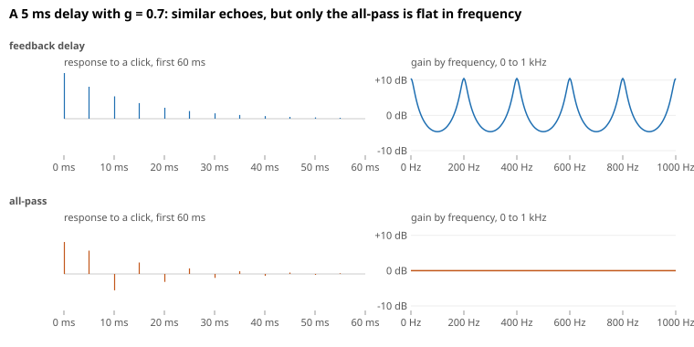
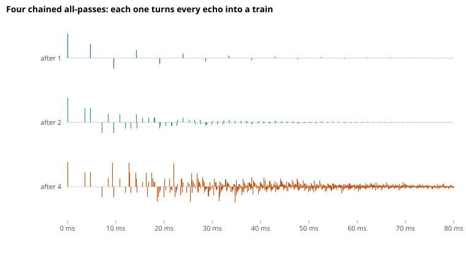
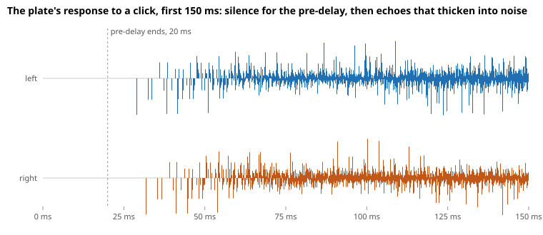
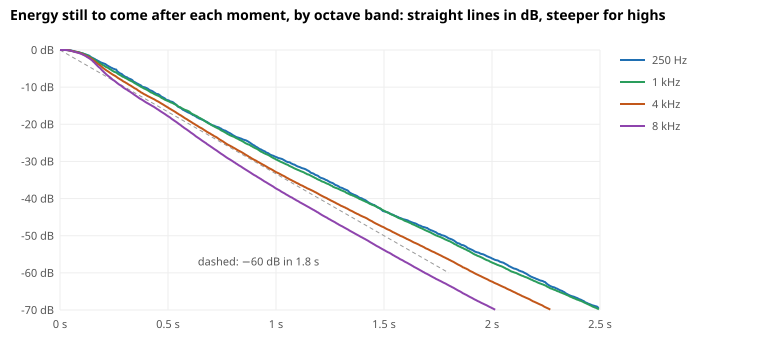

# Reverb

A sound in a hall reaches a listener first along the straight line from its source and then, over the next second or two, along countless paths that bounce off the walls. Reverb is what those bounces add. For any one source and listener position, a room acts like a filter, so everything it does to a sound is captured by how it responds to a single click, which is its impulse response. Reverberating a sound means convolving it with that response. This document develops that picture and explains why [our implementation](../../src/lib/dsp/reverb.ts), Dattorro's plate, generates a convincing response from a small network of delays instead of storing one, and how a mix shares one reverb across its tracks.

Throughout, $F_s$ is the sample rate, 48 kHz in the examples.

## Describe a Room by Its Impulse Response

A click in a hall arrives in three stages. The direct sound comes first. A few milliseconds later the first reflections arrive, off the nearest walls, floor, and ceiling, each one a distinct echo. After that, every reflection is reflected again, so the number of echoes arriving per second keeps growing until they overlap into a hiss with no individual echoes left. That **late reverberation** is most of what we hear as reverb.

Each bounce loses a fixed fraction of the sound's energy to the walls and the air, so the late reverberation loses a fixed number of decibels per second, meaning its level is a straight line in dB. The usual measure of how long it lasts is the **decay time** $T_{60}$, the time to fall by 60 dB. A medium hall is around 1.8 s. Walls, seats, and air absorb high frequencies more than low ones, so highs fade sooner and the tail darkens as it decays.

Since a room is a filter, a sound $x$ reverberated by a room with impulse response $h$ is the convolution

$$
y[n]=\sum_k h[k] \cdot x[n-k].
$$

Every input sample starts its own copy of the impulse response, scaled by its value, and the copies add up. It's the same picture as the upsampler's bumps in [Oversampling](oversampling.md#upsample-by-interpolating), except that here each bump is a whole room's echo, two seconds long.

## See Why Convolving Directly Is Costly

At 48 kHz, a 1.8 s impulse response is 86,400 samples, so computing the sum directly takes 86,400 multiplications per output sample and channel. In stereo that's about 8 billion multiplications per second. Convolution reverbs do work this way, using the FFT to make it affordable, but they also need a recorded response for every room, and changing the decay means recording or editing another one.

What makes the late reverberation sound like a room is not its exact samples, though. Once the echoes overlap, the ear hears only a few properties: how quickly the echoes thicken into hiss, how fast the hiss fades, and how much faster its highs fade than its lows. Any response with those properties sounds like a room. So instead of storing a response, a reverb can compute one that has them, with a network that reuses its own output. The plate below does it with about 40 multiplications per sample.

## Make Echoes Decay with a Feedback Delay

The simplest way to make a response that goes on and on is to feed a delay's output back to its input, which is the feedback of [Generalize the Weights and Add Feedback](digital-filters/transfer-functions.md#generalize-the-weights-and-add-feedback) with a long delay $D$:

$$
y[n]=x[n]+g \cdot y[n-D].
$$

It's what a sound does between two parallel walls $L$ apart. It comes back every $2L/c$ seconds, with $c$ the speed of sound, keeping a fraction $g$ of its level each time, which is this loop with $D=2LF_s/c$.

A click comes out at once, then again $D$ samples later at $g$, again at $g^2$, and so on. Each trip around the loop keeps the same fraction $g$, as each bounce in a room does, so the echoes fade the way a room's do. That's exponential decay, so in dB every trip lowers the level by the same $-20\log_{10}g$. A trip takes $D/F_s$ seconds, so falling 60 dB takes

$$
T_{60}=\frac{60}{-20\log_{10}g} \cdot \frac{D}{F_s},
$$

and setting $g$ sets the decay time.

The problem with one loop is that its response has only one echo per trip, at multiples of $D$, while a room's echoes keep multiplying. A long $D$ therefore sounds like a flutter of repeats, and a short $D$ makes the loop ring at the frequencies whose period divides $D$, which sounds metallic. The [appendix](#appendix-feedback-delays-as-transfer-functions) finds those frequencies from the loop's transfer function. One loop has the decay but none of the density.

## Thicken the Echoes with All-Passes

What's needed is a block that spreads a click into echoes without the loop's ringing, passing every frequency at the same gain. A filter with that property is called an **all-pass**, and adding a feedforward path to the feedback delay makes one:

$$
w[n]=x[n]-g \cdot w[n-D], \qquad y[n]=g \cdot w[n]+w[n-D].
$$

The first equation is the feedback delay with its gain negated, so a click makes $w$ the alternating train $1,-g,g^2,\dots$ at $0,D,2D,\dots$. The output adds $g$ times the train on time to the train a trip late, so each column of $y[n]$ is $g$ times the $w[n]$ entry plus the $w[n-D]$ entry:

| $n$      | $0$ | $D$     | $2D$        | $3D$         |
| -------- | --- | ------- | ----------- | ------------ |
| $w[n]$   | $1$ | $-g$    | $g^2$       | $-g^3$       |
| $w[n-D]$ | $0$ | $1$     | $-g$        | $g^2$        |
| $y[n]$   | $g$ | $1-g^2$ | $-g(1-g^2)$ | $g^2(1-g^2)$ |

Along the bottom row, the output is $g$ at once and then the feedback train shaved by the same factor $1-g^2$:

$$
y[kD]=(-g)^{k-1}(1-g^2),\qquad k\ge1.
$$

A signal's energy is the sum of its squared samples, so the click goes in with energy 1. The output's comes to

$$
g^2+\sum_{k\ge1}g^{2(k-1)}(1-g^2)^2=g^2+\frac{(1-g^2)^2}{1-g^2}=1,
$$

so the click comes out with exactly the energy it went in with, only spread over time. The [appendix](#appendix-feedback-delays-as-transfer-functions) shows the stronger fact that the shaving evens out the feedback's peaks and dips at every frequency, so the all-pass changes when the sound arrives without changing its tone. With the same delay and gain, the feedback delay's echoes come with peaks and dips across the spectrum, while the all-pass's stay flat:

Chaining all-passes multiplies their echoes, since each echo of the first becomes a whole train in the second, so a few short all-passes turn one click into a dense burst. Reverb designs call this **diffusion**. The plate's four input diffusers, below, take a click from 17 echoes after the first all-pass to more than a thousand after the fourth:

An all-pass delays a sound by $D$ samples on average across frequency, but not equally at every frequency. Its delay swings between $D(1-|g|)/(1+|g|)$ and $D(1+|g|)/(1-|g|)$, which for $g=0.5$ is from a third of $D$ to three times $D$, as the [appendix](#appendix-feedback-delays-as-transfer-functions) derives. Inside a loop, that makes some frequencies take longer to go around, which [Set the Decay Time](#set-the-decay-time) has to account for.

## Follow a Click Through the Plate

Dattorro's network combines the two ideas. All-passes make the echoes dense, a loop makes them last, and gains inside the loop make them fade. A click passes through it in this order:

$$
\text{pre-delay} \rightarrow \text{input low-pass} \rightarrow \text{4 diffusers} \rightarrow \text{tank} \rightarrow \text{output taps}.
$$

The paper gives every length in samples at 29,761 Hz. They're really durations, so they're rescaled to keep their length in seconds at the actual sample rate.

### Delay and Band-Limit the Input

The **pre-delay** holds the whole response back, here by 20 ms. In a hall, it's the gap between the direct sound and the first reflections, and in a mix it keeps a note's attack clear of its own reverb. A one-pole **low-pass** then sets how much high end enters the reverb at all. The paper's default, kept here, lets nearly the full band in.

### Diffuse Before the Tank

Four all-passes, 3.6 to 12.7 ms long, scatter the click into a burst of echoes before it reaches the loop. Without them, a sharp attack would circle the loop as one recognizable click and come back each time as a distinct repeat. With them, what the loop receives is already noise-like, and the first separate echoes in the figure are that burst reaching the outputs, already thickening.

### Circulate in a Figure Eight

The loop, which the paper calls the **tank**, has two halves. Each half runs the sound through an all-pass, a long delay, a damping low-pass, a gain, a second all-pass, a second delay, and another gain, and then feeds it into the other half, so the sound traces a figure eight through both. The input enters both halves at once. A full trip around the figure eight takes about 0.73 s, and every trip passes through four more all-passes, so the echoes keep multiplying as the response goes on, much as a room's reflections do.

The tank's delays differ from each other and share no common period, so the loop's echoes don't line up into a repeating pattern. The paper also slowly varies two of the tank's all-pass lengths to break up its resonances further. Our implementation leaves that modulation out.

### Set the Decay Time

A trip around the figure eight passes four gains, two in each half, so it lowers the level by $-80\log_{10}g$ dB in $T\approx0.73$ s, counting the all-passes by their average delay. Like the single loop above, the decay time is then

$$
T_{60}=\frac{60}{-80\log_{10}g} \cdot T,
\qquad\text{so}\qquad
g=10^{-3T/(4T_{60})}.
$$

For 1.8 s that gives $g\approx0.50$, which is also the paper's default.

Measured from the impulse response, the low frequencies take about 1.96 s to fall 60 dB, about 9% longer. The difference comes from the tank all-passes' uneven delay. A sound at a frequency where they delay longer takes longer to go around, but it still loses the same amount per trip, so it fades more slowly. The tail's last energy sits at those frequencies, which stretches the measured decay. With the tank's all-passes switched off, the same gain measures 1.79 s.

### Damp the Highs

The damping low-pass in each half is a one-pole filter with its cutoff at 6 kHz. It barely touches low frequencies, but at 8 kHz it takes away about 4 dB on each half, so 8 dB on each trip around the figure eight, on top of the gains. Highs therefore lose more per trip and fade faster, as they do in a hall, and the tail grows darker as it decays:

| Octave band | Decay time |
| ----------- | ---------- |
| 250 Hz      | 1.96 s     |
| 1 kHz       | 1.95 s     |
| 4 kHz       | 1.74 s     |
| 8 kHz       | 1.50 s     |

Each band still loses the same dB on every trip, so the dense response decays exponentially like the single loop, at a rate that the damping sets per band.

### Tap Stereo Outputs from the Tank

The plate takes one input and makes two outputs, left and right. Each output adds up seven points along the tank's delays, from both halves, with alternating signs, and the two outputs use different points. They hear the same circulating sound, so they decay alike, but at any moment they sum different echoes.

How alike two waveforms are is measured by their **correlation**, which is 1 for identical waveforms and 0 for unrelated ones. Identical left and right channels are heard as one point between the speakers, and unrelated ones as sound surrounding the listener. Measured on the impulse response from 50 ms on, the plate's outputs have a correlation of about 0, so its reverb surrounds the listener, as a room's late reverberation does, arriving from every direction.

## Share One Reverb Across a Mix

A room reverberates every source in it, and a mix gets the same effect from one reverb that every track feeds. One input is enough for that. Once the echoes overlap, the late reverberation arrives from every direction, whichever source started it, so it carries nothing about where the source stands. A listener locates a source from the direct sound and the first reflections, which arrive before it. The plate models only the late reverberation, and its pre-delay holds it back behind the direct sound, so summing every source into its one input loses nothing it could use.

Each track feeds the reverb through a **send**, a copy of the track's signal at a level set per track, and the reverb's output, its **return**, joins the mix like another track. The send is taken after the track's fader, so turning a track down or muting it takes its reverb with it. It's taken before the track's pan, since the input is summed into one signal anyway and the direct sound already places the track. A guitar panned hard left then sits on the left inside a room that still surrounds the listener.

The other place for an effect is an **insert**, in the track's own chain, as an EQ is. A reverb there reverberates only that track, and since a channel's pan comes after its inserts, the pan then acts on the reverb's stereo output. Panning a stereo signal works as a balance control, so panning the track moves its whole room to one side. A room doesn't reverberate from one side, so that's rarely what a mix wants, and it's an easy mistake to make when first putting a reverb on a single track. Sends avoid it, and one shared reverb also costs less than one per track.

## References

- J. Dattorro, [Effect Design, Part 1: Reverberator and Other Filters](https://ccrma.stanford.edu/~dattorro/EffectDesignPart1.pdf), J. Audio Eng. Soc., vol. 45, no. 9, 1997, the plate network, its default parameters, and its output taps
- M. R. Schroeder, "Natural Sounding Artificial Reverberation", J. Audio Eng. Soc., vol. 10, no. 3, 1962, the feedback delay and the all-pass as reverb building blocks
- M. R. Schroeder, "New Method of Measuring Reverberation Time", J. Acoust. Soc. Am., vol. 37, 1965, measuring the decay from the energy still to come, as the decay figure and the tests do
- J. O. Smith, [Artificial Reverberation](https://ccrma.stanford.edu/~jos/pasp/Artificial_Reverberation.html), in _Physical Audio Signal Processing_, the all-pass, the feedback delay, and the networks built from them
- [Reverb landscape](https://gist.github.com/hi-ogawa-agent/a1f910fea4abb6aa032196b991d3a864), what reverb is, its algorithms, and how mixes use it, which led to choosing this plate

## Appendix: Feedback Delays as Transfer Functions

> 🚧 TODO: not yet internalized by the author.

The main text describes the feedback delay and the all-pass by their echoes. Their behavior across frequency comes from the method of [Waves, Feedback, and Transfer Functions](digital-filters/transfer-functions.md#generalize-the-weights-and-add-feedback). Substitute $x[n]=z^n$ and $y[n]=H(z)z^n$, so a delay of $D$ samples multiplies by $z^{-D}$, and evaluate on the unit circle $z=e^{j\omega}$ for a steady tone.

**The feedback delay.** Substituting into $y[n]=x[n]+g \cdot y[n-D]$ gives $H=1+gz^{-D}H$, so

$$
H(z)=\frac{1}{1-gz^{-D}}.
$$

Its poles solve $z^D=g$, so for $0\lt g\lt1$ they are

$$
z_k=g^{1/D}e^{j2\pi k/D},\qquad k=0,\dots,D-1.
$$

Every pole has the same radius $g^{1/D}$, so every mode loses the same factor $g$ over $D$ samples, which is the per-trip loss of the main text. The angles $2\pi k/D$ are the frequencies $kF_s/D$, which is where the loop rings. For the two walls of the main text, they're $kc/(2L)$, the frequencies whose half-wavelength fits a whole number of times between the walls, which are the standing waves of that space. On the unit circle the gain is $1/|1-ge^{-j\omega D}|$. It's largest, $1/(1-g)$, where $e^{-j\omega D}=1$, at those same frequencies, and smallest, $1/(1+g)$, halfway between them. For $g=0.7$ that's +10.5 dB and −4.6 dB, and with $D$ at 5 ms the peaks repeat every 200 Hz, as in the figure.

**The all-pass.** Substituting into $w[n]=x[n]-g \cdot w[n-D]$ gives $W=X/(1+gz^{-D})$, and then $y[n]=g \cdot w[n]+w[n-D]$ gives

$$
H(z)=\frac{g+z^{-D}}{1+gz^{-D}}.
$$

On the unit circle, write $u=e^{-j\omega D}$, so $|u|=1$ and $u\bar u=1$. Then the numerator is $g+u=u(1+g\bar u)$, and for real $g$, $|1+g\bar u|=|1+gu|$, so the numerator and denominator have the same magnitude and $|H|=1$ at every frequency. Expanding $1/(1+gz^{-D})$ as the geometric series $\sum_k(-g)^kz^{-kD}$ and multiplying by $g+z^{-D}$ gives the impulse response of the main text,

$$
g,\quad 1-g^2,\quad -g(1-g^2),\quad g^2(1-g^2),\quad\dots
$$

at $0, D, 2D, 3D,\dots$ samples.

**The all-pass's uneven delay.** A sound at frequency $\omega$ is delayed by the slope of the phase, $-d\arg H/d\omega$. For $H$ above, that's

$$
\tau(\omega)=\frac{D(1-g^2)}{1+2g\cos\omega D+g^2}
$$

samples. It's smallest where $\cos\omega D=\operatorname{sign}g$, at $D(1-|g|)/(1+|g|)$, and largest where $\cos\omega D=-\operatorname{sign}g$, at $D(1+|g|)/(1-|g|)$. Its average over all frequencies is exactly $D$, because as $\omega$ goes once around the circle, the numerator $g+z^{-D}$ winds $D$ times around 0 and the denominator not at all, so the phase falls by $2\pi D$ in all.
