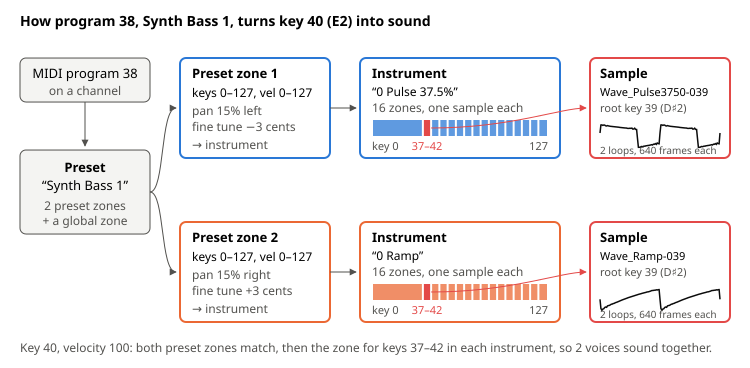
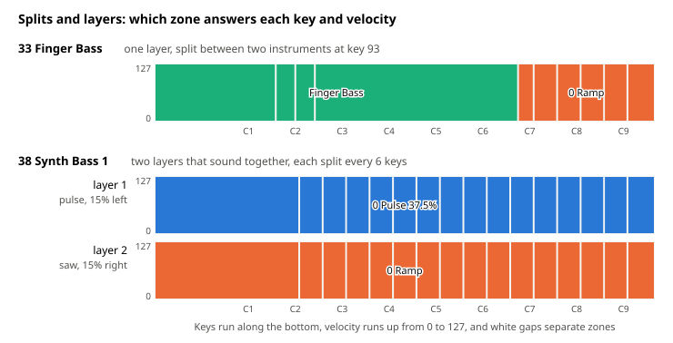
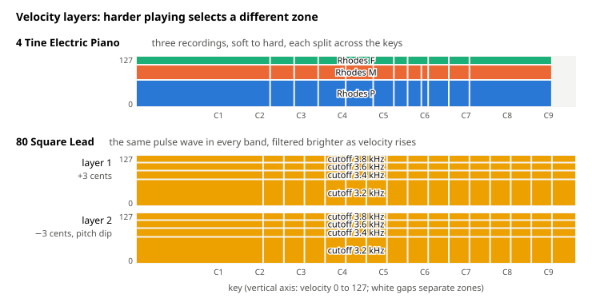
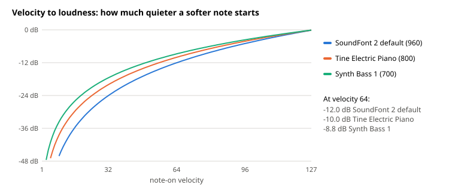

# What a SoundFont Preset Is Made Of

A MIDI track names a sound only by a program number, as [what a MIDI file can encode](midi-file-model.md) explains, and the SoundFont decides what that number sounds like. This document builds a model of what a SoundFont preset contains: the chain from preset to instrument to sample, the zones that map keys and velocities to samples, the generators that set each zone's sound, and the modulators that connect playing to sound. Every example is decoded from GeneralUser GS, which is the SoundFont Toy MIDI bundles, through SpessaSynth, which is the engine that plays it. The [synth preset atlas](https://gisthost.github.io/?ddfeba128a7ee1be7ab5c2c08b015b43/synth-preset-atlas.html) is the hearable companion, with clips and decoded voices for the synth presets used here.

## Follow a Program Down to Samples

A SoundFont is three tables that point into each other.

- **A sample** is a recording, or a single cycle of a waveform, with the key it sounds at unchanged (its root key) and a loop to repeat while the note is held.
- **An instrument** maps notes to samples. It is a list of zones, and each zone says "for these keys and these velocities, play this sample, with these settings".
- **A preset** is what a program number selects. It is a list of zones too, but each zone points to an instrument instead of a sample, and its settings adjust the instrument's.

Playing a note walks down the chain. The synth finds every preset zone that contains the note's key and velocity, then, inside each zone's instrument, every instrument zone that contains them, and starts one voice for each match. A voice is one sample playing through its own filter and envelopes. So one key press can start several voices, and in Synth Bass 1 every key starts two.

An audio analogy is a sampler patch inside a rack. The instrument is a multisampled patch, meaning a key and velocity map of recordings with an envelope and a filter per zone. The preset is a rack with one chain per preset zone, where each chain has its own key and velocity zone and can offset the patch's knobs. Ableton's Instrument Rack, with key and velocity zones per chain, is close to the same shape.

## Map Notes with Zones

A zone is a rectangle on a key by velocity plane, plus the settings to use inside it. Arranging rectangles gives three patterns, and real presets mix them.

**Splits** are zones side by side across the keyboard, so different keys play different samples. A sample played away from its root key is resampled, which changes its length and its timbre along with its pitch, so a multisampled instrument switches samples every few keys. Finger Bass also shows that a split can switch instruments. Its preset maps keys 0 to 92 to the recorded finger bass and keys 93 and up to a ramp wave, so the top of the keyboard is a synth.

Synth Bass 1 splits for a different reason. Its samples are single cycles, meaning one period of a pulse or a saw, and the instrument has a new one every 6 keys, each with its root key near the middle of its zone, so no sample plays more than a few semitones above its root. A single cycle stored at the sample rate holds harmonics up to the Nyquist limit at its root key, and playing it higher pushes the top harmonics past that limit, where they alias, which is the same problem as in [oversampling](oversampling.md). The cycles get shorter up the keyboard, from 800 frames for A1 to 25 frames for A6.

**Layers** are zones that cover the same rectangle, so one note plays all of them at once. Synth Bass 1 has two preset zones over the whole keyboard, one pointing to a 37.5% pulse and one to a saw (the instrument calls it a ramp). The pulse is tuned 3 cents flat and panned 15% left, and the saw 3 cents sharp and 15% right, so the two beat slowly against each other and spread in stereo. What a General MIDI name presents as one sound is, here, two oscillators in a classic detuned stack.

**Velocity layers** are zones stacked by velocity, so playing harder selects a different zone. Tine Electric Piano has three sets of recordings, played softly (velocity 0 to 67), medium (68 to 105), and hard (106 to 127), and each is split across the keyboard with its own samples. That is how a sampled piano gets brighter and more barky when struck harder, because a hard hit is a different recording, not a louder soft one.

Square Lead stacks velocity bands without changing the sample. All eight of its preset zones point to the same 50% pulse instrument, as two layers of four bands, at velocities 0 to 66, 67 to 88, 89 to 108, and 109 to 127. The bands differ only in their settings. Each band opens the filter a little more (3.2, 3.4, 3.6, and 3.8 kHz at middle C) and sweeps it further at the attack, so harder playing selects a brighter copy of the same wave. A band boundary is a jump, so velocities 88 and 89 differ by a whole band in brightness, while loudness changes smoothly through a modulator, described below.

**Global zones** hold settings shared by every zone of a preset or an instrument. A setting in a zone replaces the global value for that zone. Square Lead's global zone tunes everything 3 cents sharp, and its second layer's zones set −3 cents, which replaces it rather than adding to it, so the layers sit at +3 and −3 cents.

## Set Each Zone's Sound with Generators

The settings in a zone are generators, which are numbered parameters with one value each. Together they describe a small subtractive synth voice wrapped around the sample:

- **Tuning:** coarse tune in semitones, fine tune in cents, an override of the sample's root key, and how many cents each key moves (100 for normal keyboard tracking)
- **Pan and level:** pan, and attenuation in centibels (tenths of a dB)
- **A lowpass filter:** cutoff and resonance
- **A volume envelope:** delay, attack, hold, decay, sustain, release
- **A modulation envelope** with the same stages, routed to pitch and to filter cutoff by its own depth generators
- **Two LFOs**, each with a delay and a rate: a vibrato LFO routed to pitch, and a modulation LFO routed to pitch, filter cutoff, and volume
- **Sample playback:** loop mode, offsets into the sample, and an exclusive class, which stops other notes of the same class, as with an open and a closed hi-hat

The units are logarithmic. Pitch and cutoff are in cents, levels in centibels, and times in timecents, where 1200 timecents doubles a time. Logarithmic units make a fixed offset mean the same musical change everywhere, meaning a number of semitones for cutoff or a ratio for a time.

That is what makes the two levels combine simply. **An instrument zone sets absolute values**, starting from the defaults of the format for anything it leaves out. **A preset zone sets offsets**, which are added to the instrument's values. Because the units are logarithmic, adding cents to a cutoff moves it by an interval, and adding timecents to a time scales it. Here is what that gives for key 40 at velocity 100 in Synth Bass 1's pulse layer, decoded from the voice SpessaSynth builds:

| Generator             | Instrument (absolute) | Preset (added) | Voice             |
| --------------------- | --------------------- | -------------- | ----------------- |
| Attack (volume)       | 100 ms                | ×0.010         | 1.0 ms            |
| Decay (volume)        | 1.00 s                | ×23            | 22.7 s            |
| Sustain (volume)      | 0 dB below peak       | 100 dB         | 100 dB below peak |
| Release (volume)      | 1.00 s                | ×0.50          | 500 ms            |
| Filter cutoff         | 200 Hz                | −35 cents      | 196 Hz            |
| Filter envelope depth | 0 cents               | +1500 cents    | +1500 cents       |
| Decay (filter env)    | 1.00 s                | ×0.20          | 200 ms            |
| Pan                   | center                | 15% left       | 15% left          |
| Fine tune             | 0 cents               | −3 cents       | −3 cents          |

GeneralUser GS uses this split by design. Its waveform instruments, such as the pulse and the saw, are generic, with a 200 Hz cutoff and envelopes of round values, and presets reuse them with their own offsets, as 13 presets do with the saw. Synth Bass 1's preset turns the generic pulse into a bass, meaning an instant attack, a long fade while held (from 0 dB to silence over 22.7 s), and a filter envelope that settles within 200 ms. Its saw layer gets different offsets on the same generic saw, with a 350 Hz cutoff, a shallower and quicker filter envelope, and the opposite pan and detune. Instrument zones also set generators per zone, so Tine Electric Piano's soft layer sets a different cutoff for each sample, from 150 Hz on its lowest sample to 1.5 kHz on its highest.

The generators are the voice at rest. What the player does, such as velocity, the key, and the controllers, moves them through modulators.

## Route Playing to Sound with Modulators

A modulator is a route from a source to a generator. The source is a performance value, meaning velocity, key number, a control change, pitch bend, or pressure. It goes through a curve (linear, concave, convex, or a switch), is scaled by an amount, and is added to the destination generator. An optional second source multiplies the first, as pitch bend times bend range does. Velocity and key are fixed when the note starts, and controller routes update while the note is held, so turning CC74 changes the cutoff of notes already sounding.

Synth Bass 1's preset defines three modulators, and they explain how it responds to playing.

- **Velocity → filter envelope depth, +4898 cents at full velocity.** This adds to the +1500 cents in the table, so harder playing sweeps the filter further at the attack. At key 40 the filter starts at about 235 Hz and peaks at about 1.4 kHz at velocity 40, 5.1 kHz at velocity 100, and 9.2 kHz at velocity 127, before settling within 200 ms. Velocity sets the brightness of the pluck.
- **Key → cutoff, +1000 cents across the whole keyboard.** This is partial key tracking, about 8 cents per key, so higher notes are a little brighter without tracking the pitch fully.
- **Velocity → attenuation, 700.** This is the velocity-to-loudness curve. The pulse instrument switches the default curve off with a matching modulator of amount 0, and the preset adds 700 to it, so the voice gets a flatter curve than the default of 960.

The default velocity curve makes the amplitude proportional to the square of velocity, so half velocity is 12 dB down. A smaller amount makes soft playing louder relative to hard playing, which suits a synth bass that should not disappear at low velocities.

A voice's full list of modulators comes from three places, and SpessaSynth combines them in a fixed way.

1. **The SoundFont's own modulators,** in the instrument zone, the instrument's global zone, the preset zone, and the preset's global zone. Instrument modulators are absolute and preset modulators add their amount to a matching one, the same rule as generators. Two modulators match when they have the same sources, curves, and destination.
2. **The SoundFont 2 defaults,** which the specification applies to every preset unless an instrument defines a matching modulator, which then replaces the default.
3. **SpessaSynth's own defaults,** which it appends to the specification's list, so they also apply to every preset.

The defaults are the reason the same controllers work on every preset:

| Source                      | Destination                  | Amount                        | Defined by  |
| --------------------------- | ---------------------------- | ----------------------------- | ----------- |
| Velocity (concave)          | Attenuation                  | 960                           | SoundFont 2 |
| CC1 modulation wheel        | Vibrato LFO to pitch         | 50 cents                      | SoundFont 2 |
| Channel pressure            | Vibrato LFO to pitch         | 50 cents                      | SoundFont 2 |
| CC7 volume, CC11 expression | Attenuation (concave)        | 960 each                      | SoundFont 2 |
| CC10 pan                    | Pan                          | full left to full right       | SoundFont 2 |
| Pitch bend × bend range     | Fine tune                    | the bend range                | SoundFont 2 |
| CC91, CC93                  | Reverb and chorus send       | 20%                           | SoundFont 2 |
| CC74 brightness             | Cutoff                       | ±4800 cents                   | SpessaSynth |
| CC71 resonance              | Filter resonance             | ±12.5 dB                      | SpessaSynth |
| CC73, CC72, CC75            | Attack, release, decay times | ±3000, ±1800, ±1800 timecents | SpessaSynth |
| CC67 soft pedal             | Cutoff                       | −1200 cents                   | SpessaSynth |

The controller routes from SpessaSynth are bipolar around the controller's center, which is 64. So CC74 at 64 leaves the cutoff where the preset put it, 127 opens it 4 octaves, and 0 closes it 4 octaves, which is what the CC74 sweeps in the atlas play on every preset, although GeneralUser GS never mentions CC74. The modulation wheel works the same way through a SoundFont 2 default. Synth Bass 1's vibrato LFO runs at 5 Hz with no depth of its own, and CC1 adds up to 50 cents of depth to it, so the wheel brings in vibrato that the preset only prepared. The specification also lists a default from velocity to cutoff, but SpessaSynth leaves it out, so in Toy MIDI velocity changes brightness only where a SoundFont routes it, as Synth Bass 1 does.

GeneralUser GS's instruments interact with these defaults on purpose. Its waveform and Rhodes instruments carry a velocity-to-attenuation modulator, which replaces the default, and two velocity-to-cutoff modulators with an amount of 0, which switch off the velocity-to-cutoff default in players that have one. They also raise the reverb and chorus sends, but Toy MIDI turns SpessaSynth's built-in effects off, so MIDI tracks stay dry and those routes do nothing.

## Read a General MIDI Name as a Patch

Put together, a General MIDI name like Synth Bass 1 stands for a patch that the name does not hint at, made of two detuned and panned oscillators, each a stack of single-cycle samples, through a lowpass filter whose envelope depth follows velocity, with a long fade, a vibrato waiting on the modulation wheel, and cutoff, resonance, and envelope times on CC71 to CC75. Another SoundFont's Synth Bass 1 can be built in a completely different way, because General MIDI only fixes the name. Knowing the structure explains why a preset reacts to velocity or a controller the way it does, and what an edit would have to change to make it react differently.
