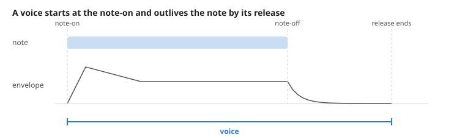

# How the Synth Plays a Patch

Toy MIDI's own [synth](../../src/lib/dsp/subtractive-synth.ts) has two kinds of things that are easy to mix up. Its patch is a set of settings that every note shares. Its voices are what is sounding right now, one per note. This document draws them as a grid and follows a sample through it.

## Picture Layers and Voices as a Grid

- **A layer** is one row of the patch: an oscillator waveform, a gain, and an amp envelope. The patch is the synth's settings for one track, and every note plays every layer at once.
- **A voice** is one column, the synth playing one note. It holds what belongs to the note, which is its pitch, its oscillator phase, and a gain from its velocity, velocity / 127.
- **A cell** is one layer sounding in one note. It holds the only state that belongs to both, which is how far that layer's envelope has gone in that note.

For each output sample, every cell multiplies its layer's oscillator by the layer's gain and by its envelope level. Each voice sums its column and applies its velocity gain. The synth sums the voices and applies the channel gain from CC7 volume and CC11 expression, and the result goes through the track's channel, as [audio signal flow](../audio-signal-flow.md) shows.

## Tell a Note from Its Voice

A note is the MIDI event that a person or an agent writes, with a pitch, a velocity, a note-on, and a note-off. Its voice starts at the note-on but ends only when every layer's release has finished, so it keeps sounding after the note-off.

## Tell the Three Forms of an Envelope Apart

The word envelope covers three things, one for each place in the grid.

- **The settings** are the attack, decay, sustain, and release in a layer's row, as [ADSR envelopes](adsr-envelopes.md) explains.
- **The curves** are those settings turned into a per-sample step for each stage. The synth computes them once per layer when the patch changes.
- **The position** is a cell's current stage and level, the dot in the grid. Each note starts its own at 0.

## Edit a Patch While Notes Sound

An edit to a layer changes its row, and the cells read their row on every sample. So editing a layer's gain, waveform, or envelope reaches notes that are already sounding, and a held note releases with a new release time.

Adding or removing a layer changes the rows themselves. A cell finds its row by its position in the list, so after a removal the cells below it would line up with the wrong layers. Instead, the synth stops every sounding note when the number of layers changes, and the next note plays the new patch. Giving each layer an id, as tracks have, would let cells follow their layer and keep held notes sounding.
