# Amp sim prototype

Can a clean DI guitar through a simple amp sim beat General MIDI's distorted guitars? This prototype answers that offline, before Toy MIDI builds an amp sim (#934). It renders two demo pieces from llm-music-probe, [Quiet-Loud in E](https://github.com/hi-ogawa/llm-music-probe/tree/main/compositions/pieces/quiet-loud-in-e) and [Open E Mixolydian](https://github.com/hi-ogawa/llm-music-probe/tree/main/compositions/pieces/open-e-mixolydian), whose guitar tracks are on the FlameStudios Telecaster bridge font and named by the gain they get (Clean, Crunch, High Gain), and runs each guitar track through an amp in ffmpeg.

## Result

Yes. The final chain sustains like General MIDI's distortion, keeps the DI's pick attack, which General MIDI's samples lack, and stops cleanly between notes.

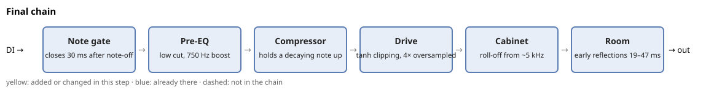

Each stage is there because of something heard along the way, so the iterations below are the explanation.

### In guitarist terms

The stage names are DSP terms, named for what each stage does to the signal. A guitarist would describe the same chain as pedals, an amp, and a recording, and names like "pre-EQ" aren't something they'd say:

| Stage      | What a guitarist would call it                                                                                                                                                                                                                                                                                                         |
| ---------- | -------------------------------------------------------------------------------------------------------------------------------------------------------------------------------------------------------------------------------------------------------------------------------------------------------------------------------------- |
| Note gate  | A noise gate pedal, which high-gain players use to silence the amp between notes, though a real one opens on the signal's level rather than on note-offs. Muting with the hands does most of this job on a real guitar.                                                                                                                |
| Pre-EQ     | The tone shaping of an overdrive pedal used as a boost in front of the amp, such as a Tube Screamer, whose low cut and mid hump tighten palm mutes and help the distortion cut through a mix. The pedal also clips a little, which the chain leaves to the drive. Players treat it as a pedal that's on or off, not as an EQ to tweak. |
| Compressor | A compressor pedal at the start of the chain. It's common for clean and country playing, while high-gain amps compress the signal on their own.                                                                                                                                                                                        |
| Drive      | The amp's preamp, set by its gain knob and channel, clean, crunch, or lead. The cascaded stages are how a high-gain amp gets more distortion than one stage could give.                                                                                                                                                                |
| Cabinet    | The speaker cabinet and the microphone in front of it. Amp sim plugins call this "cab sim", and it's the one stage a guitarist would name the same way.                                                                                                                                                                                |
| Room       | The room the cabinet is recorded in, picked up by a room mic, or a short reverb.                                                                                                                                                                                                                                                       |

The order doesn't follow a pedalboard. A guitarist would put the compressor pedal first and the boost after it, but the chain puts the compressor after the pre-EQ, right before the drive, because its job here is to keep a decaying note pushed into the clipper, and the low cut in front keeps the bass from triggering it. Without the compressor, the chain reads as a guitar rig would: a boost pedal's tone, the amp, the cabinet, the room.

Two parts of a real amp aren't modeled. The tone stack, the bass, middle, and treble knobs that guitarists tweak for tone, sits after the preamp, so it changes how the distortion sounds rather than how hard the amp breaks up. And the power amp adds its own compression and saturation when played loud.

### The drive in math

The drive runs on float samples at 4× the sample rate, upsampled before the first gain and downsampled after the last clipper by ffmpeg's resampler. Dry tracks come out of fluidsynth at `-g 0.5`, which puts the guitar tracks' peaks at about −5 dBFS (0.56) for open strokes and about −11 dBFS (0.28) for muted ones, and the gains below are tuned for that level.

Each clipper is ffmpeg's `asoftclip=type=tanh` at its defaults, which is y = tanh(x). tanh is close to linear for small x and flattens toward ±1 for large x, so a stage with gain g on input x gives y = tanh(g·x): the larger g, the more of the wave is flattened. tanh is odd, tanh(−x) = −tanh(x), so it flattens both halves alike and adds only odd harmonics.

Each curve below is a whole drive, input sample in and output sample out, without the filters between stages. Near 0 a curve is steep, so a quiet input comes out much louder, and past a small input it flattens toward ±1, so louder inputs barely come out louder:

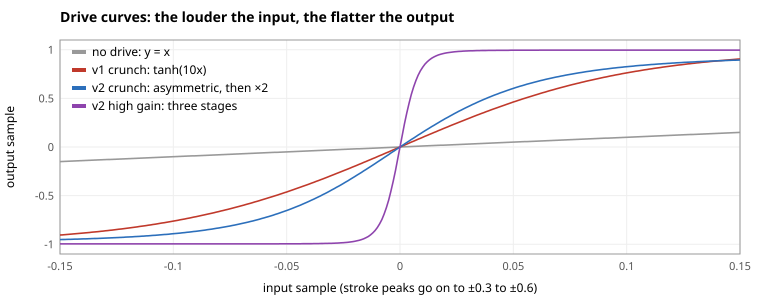

The asymmetric stage adds a DC offset before the clipper, y = tanh(g·x + 0.15), and a 20 Hz high-pass after it removes the constant tanh(0.15) ≈ 0.149 again. The offset moves the wave up the curve, so its top half flattens more than its bottom half, which adds even harmonics, the way a tube stage biased off center does.

A guitar's peaks, from 0.3 to 0.6, sit far out on these curves, where every drive gives nearly a square wave. A quiet input, such as a note decaying, shows how they differ: v1 crunch only rounds it, and v2 high gain still squares it, which is why high gain sustains:

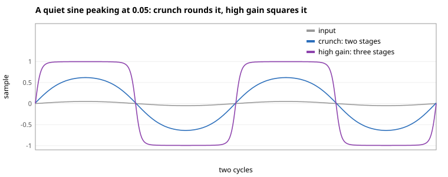

The flattening adds harmonics, multiples of the note's frequency, and they're what makes the sound distorted. The symmetric v1 crunch adds only odd ones, while the offset in v2 adds even ones too:

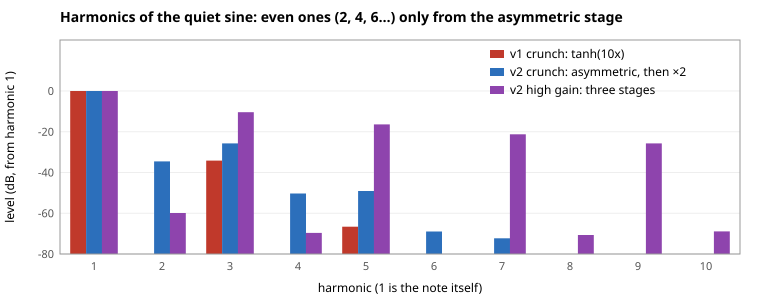

Gains in dB, with the factor, from pre-EQ output to the cabinet:

| Amp, gain level | Stages                                                                                                             |
| --------------- | ------------------------------------------------------------------------------------------------------------------ |
| `v1`, crunch    | ×10 (20 dB) → tanh                                                                                                 |
| `v1`, high gain | ×15.8 (24 dB) → tanh → +3 dB peak at 1 kHz → ×4.0 (12 dB) → tanh                                                   |
| `v2`, crunch    | ×7.9 (18 dB) → asymmetric tanh → +2 dB peak at 1 kHz → ×2.0 (6 dB) → tanh                                          |
| `v2`, high gain | ×7.9 (18 dB) → asymmetric tanh → 120 Hz high-pass, +3 dB peak at 1 kHz → ×5.0 (14 dB) → tanh → ×3.2 (10 dB) → tanh |

After the drive, ×0.126 (−18 dB) brings the level back down before the cabinet, and loudness matching sets the final level. `v2`'s compressor, when on, sits before the first gain, and its clean level is the compressor alone, so `--no-comp` leaves clean tracks dry.

TODO: wrong, clean tracks still get the −18 dB, the mono fold, and the cabinet.

## Iterations

Each step changes one thing, shown in yellow in its chain diagram, all on the filter cabinet the chain ships with, and the cabinet gets its own comparison at the end. Every render is normalized to −16 LUFS, so a comparison is about tone, not level, because the louder of two versions tends to sound better, and drive makes a track much louder. Each guitar track is also matched to its dry loudness before mixing, so the amp doesn't move it in the mix.

TODO: not every step changes one thing. Step 2 adds three stages, step 3 changes the compressor and the drive together, and step 5 runs on the IR rather than the filter cabinet. The tags name the variants to compare, [Reproduce](#reproduce) generates them, and `gen-figures.ts` draws the plots from those renders.

The session didn't run in this order. Its v2 round added the Marshall cabinet IR together with the amp changes, so the gate and the room were first heard with the IR. Step 6 found the IR and the filters interchangeable, and the gate was then confirmed on the filter-cabinet pair, so the steps follow the cleaner order.

### 1. No amp (`tele-dry`)

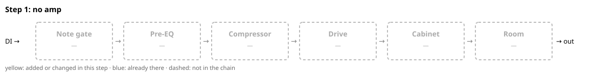

A clean Telecaster bridge pickup is the classic country sound, so the riffs sound like rock played on a country tone. The writing already reads as guitar, so the missing piece was the amp.

### 2. Drive (`v1` against `tele-dry`)

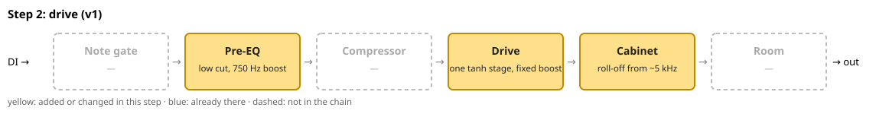

- **Pre-EQ:** a high-pass at 90 Hz (12 dB per octave) so the low end stays tight under distortion, and a peak of +4 dB at 750 Hz, 1.2 octaves wide, for the mid hump of an overdrive pedal in front of an amp. It's a rough stand-in for the pedal's tone: a Tube Screamer gets its hump mostly by cutting lows and highs rather than with a peak.
- **Drive:** a fixed boost into a tanh soft clipper, which rounds off the peaks and adds harmonics. [The drive in math](#the-drive-in-math) has the formulas and gains.
- **Cabinet:** filters standing in for a guitar speaker, mainly low-passes that roll off from about 5 kHz. Step 6 lists the filters and shows why they're there.

**Heard:** better than clean. But General MIDI's distortion (`gm`) sustains more convincingly, even though its samples have no pick attack.

**Why:** a fixed boost clips the start of a note, but as the DI string decays, the signal falls below the clipping point and the note cleans up. General MIDI's samples were recorded through a real amp, whose compression keeps the decaying string saturated. The font isn't the cause, since its samples sustain a full 6-second note.

### 3. Sustain (`v2` against `v1`)

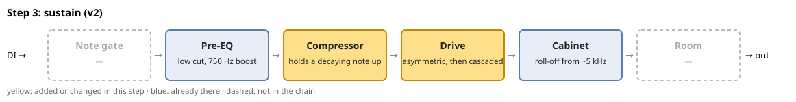

- **Compressor:** turns a note up as it decays, so the string stays pushed into the clipper instead of cleaning up.
- **Drive, changed:** the first stage clips asymmetrically, because a DC offset before the clipper flattens one half of the wave more than the other, which adds even harmonics like a tube stage. High gain adds two more stages that each clip a little, the way a high-gain preamp does, instead of one hard push. A small mid peak between stages, +2 dB at 1 kHz on crunch and +3 dB on high gain, keeps adding to the hump.

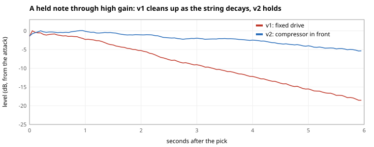

**Heard:** a good addition, but sustain leaks and muddies the phrasing and articulation.

**Why:** the synth doesn't stop a note at its note-off, where a guitarist would mute the string, but fades it out over the SoundFont's release, a beat or so. Dry, that tail sits under the notes. Both the drive and the compressor bring quiet parts up toward loud ones, so they bring the tail up too, until it smears into the next note. Measured 60 to 400 ms after each note-off on both pieces' guitars, the tail is 14 to 23 dB below the notes dry, 8 to 20 dB with the drive alone (`v1`), and 3 to 14 dB with the compressor in front (`v2`).

### 4. Note gate (`v2-gate-filtercab` against `v2`)

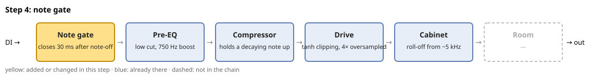

- **Note gate:** the amp's input stays open while a note is held and closes over 30 ms after its note-off, like the fretting hand letting go of the string.

A real high-gain rig uses a noise gate on the audio level, and that was tried first, with no measurable effect. The leaking decay sits between about −30 and −50 dB, so a threshold high enough to cut it would also cut a held note's sustain. Only the note-off tells "let go" from "still holding", and Toy MIDI has every note-off, which a real amp doesn't.

Two bars of Open E Mixolydian's muted riff, with each note's held span in green. Without the gate, every note keeps sounding for about a beat after its green span, decaying slowly:

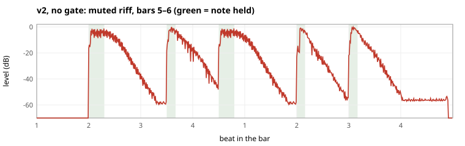

With the gate, the level drops right after each note-off:

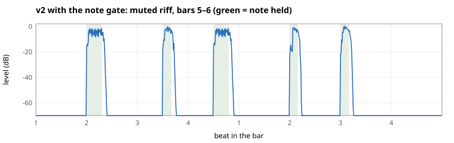

| Track                    | Level after note-off, below the notes: v2 | with the gate |
| ------------------------ | ----------------------------------------- | ------------- |
| Quiet-Loud crunch, muted | 16 dB                                     | silent        |
| Quiet-Loud high gain L   | 21 dB                                     | 43 dB         |
| Open E riff, muted       | 12 dB                                     | 50 dB         |
| Open E riff, open        | 7 dB                                      | 53 dB         |

**Heard:** the gate is the fix, with good nuance, though the cut is unusually hard.

### 5. Room (`v2-ir-gate-room` against `v2-ir-gate`)

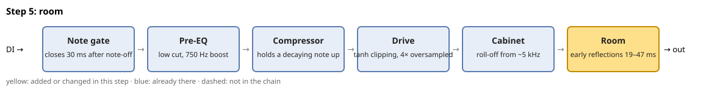

- **Room:** three early reflections at 19 to 47 ms, after the amp. A recorded guitar always carries some room, and that's what softens a note's end in real life. A room before the drive would itself get distorted and smear again, and a long one on fast parts would bring the blur back.

TODO: the room comes after the loudness match and lowers the guitars by about 5 dB in the full mix, so this pair differs in level too. Match after the room and re-render.

**Heard:** all good. This pair was rendered with the IR cabinet.

### 6. Cabinet: none, filters, or IR (`v2-gate-nocab`, `v2-gate-filtercab`, `v2-ir-gate`)

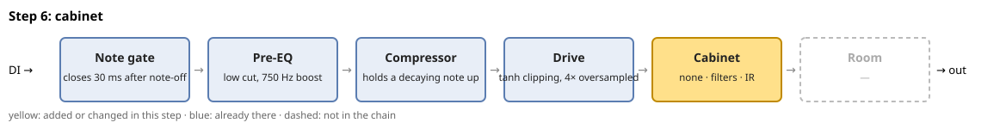

The same gated chain three ways. The filter cabinet is ffmpeg's two-pole filters, each a Butterworth (Q 0.71) falling 12 dB per octave past its cutoff, and two peaking EQs:

| Filter                                          | What it does                                                                                                                               |
| ----------------------------------------------- | ------------------------------------------------------------------------------------------------------------------------------------------ |
| High-pass at 75 Hz                              | Cuts the lows below what a guitar speaker reproduces                                                                                       |
| Low-pass at 5.2 kHz twice, then at 7 kHz        | The roll-off. Together they fall 36 dB per octave once past 7 kHz: −1 dB at 3 kHz, −7 dB at 5.2 kHz, −21 dB at 8 kHz, and −31 dB at 10 kHz |
| Peak of +3 dB at 2.4 kHz, 1 octave (Q 1.41)     | The presence bump, the upper-mid edge a speaker has just below its roll-off                                                                |
| Peak of −2.5 dB at 450 Hz, 1.5 octaves (Q 0.92) | A low-mid dip, which keeps a distorted guitar from sounding boxy                                                                           |

The IR is a recorded Marshall 1960A 4×12 cabinet with an SM57.

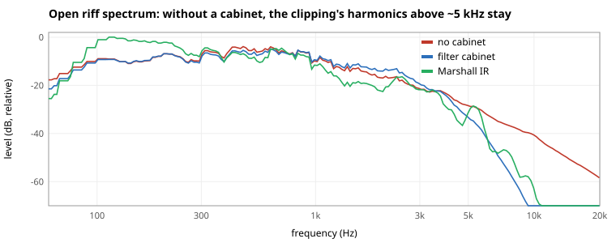

**Heard:** without a cabinet it sounds fuzzed and bad. The filters and the IR sound different, but neither is clearly better in any particular way, so the filter cabinet is enough for now and a recorded IR is deferred.

**Why:** clipping adds harmonics far above what a guitar speaker reproduces. A real speaker rolls them off from about 5 kHz, so without a cabinet they come through as raw fizz. That roll-off is most of a cabinet's job, which is why the filters and the IR end up close. The IR also carries a speaker resonance around 100 Hz that the filters don't.

## Pitfalls

Two ffmpeg details that silently broke the drive, worth knowing for an implementation:

- **Clipping before the clipper.** ffmpeg kept the 16-bit sample format through the chain, so the +24 dB boost hard-clipped before the tanh stage saw the signal. The chain runs in float.
- **Oversampling that overshoots.** `asoftclip`'s own oversample option produced peaks about 9 dB above full scale. Resampling to 4× around the drive stages explicitly is the textbook way, and it stays bounded.

## Open

- **A cabinet IR, deferred.** The Marshall IR is from https://github.com/fnpngn/IR, a collection of freely shared IRs, and isn't committed here, because its license doesn't say it can be redistributed. Step 6 found no clear gain over the filter cabinet, so an IR that Toy MIDI may ship is a later upgrade, not a requirement.
- **The gate's release.** 30 ms is a quick fretting-hand mute. 50 to 80 ms may sound more natural on open riffs.

## Reproduce

`amp-sim.ts` loads a project as the app does, writes each MIDI track as its own MIDI file with the app's Export MIDI, renders it with fluidsynth on the track's SoundFont, and runs the guitar tracks through the amp. It needs `fluidsynth`, `ffmpeg`, and `ffprobe` on `PATH`, and the bundled SoundFonts from `pnpm fetch-soundfonts`.

Download the two pieces from llm-music-probe:

```sh
mkdir -p /tmp/ampsim
curl -sLo /tmp/ampsim/quiet-loud.json https://raw.githubusercontent.com/hi-ogawa/llm-music-probe/main/compositions/pieces/quiet-loud-in-e/quiet-loud.json
curl -sLo /tmp/ampsim/riff.json https://raw.githubusercontent.com/hi-ogawa/llm-music-probe/main/compositions/pieces/open-e-mixolydian/project.json
```

Each call writes one variant as `<tag>.mp3` and `<tag>-guitars.mp3`, with the guitars soloed:

```sh
run() {
  pnpm amp-sim /tmp/ampsim/quiet-loud.json --out /tmp/ampsim/quiet-loud "$@"
}
run --tag gm --gm
run --tag tele-dry --amp none
run --tag v1 --amp v1
run --tag v2 --amp v2
run --tag v2-ir --amp v2 --ir <cabinet.wav>
run --tag v2-ir-gate --amp v2 --note-gate --ir <cabinet.wav>
run --tag v2-ir-gate-room --amp v2 --note-gate --ir <cabinet.wav> --room
run --tag v2-gate-filtercab --amp v2 --note-gate
run --tag v2-gate-nocab --amp v2 --note-gate --no-cab
```

`--amp none` leaves the guitars as rendered, and `--gm` renders the guitar tracks on General MIDI's Clean (27), Muted (28), Overdriven (29), and Distortion (30) Guitar instead.

Each track renders dry, at the MIDI default volume and centered, because Export MIDI leaves out the mixer's gain and pan, and the script applies them after the amp. The drive depends on input level, so the amp is tuned for that default volume.

The figures come from renders of [`held-note.json`](held-note.json), three notes held for 6 seconds on one high-gain track, and of Open E Mixolydian:

```sh
pnpm amp-sim tools/amp-sim/held-note.json --out /tmp/ampsim/held --tag v1 --amp v1
pnpm amp-sim tools/amp-sim/held-note.json --out /tmp/ampsim/held --tag v2 --amp v2
# /tmp/ampsim/riff.json into /tmp/ampsim/riff, with the tags v2, v2-gate-filtercab, v2-gate-nocab, and v2-ir-gate
pnpm exec tsx tools/amp-sim/gen-figures.ts --held-note /tmp/ampsim/held --riff /tmp/ampsim/riff --riff-project /tmp/ampsim/riff.json
```
